# Week 09: 10/23/2026

## Agenda

1. [Housekeeping](#housekeeping)
2. [Share Assignment #6 [Part 2]](#share-assignment-6-part-2)
3. [Lecture #7 Discussion: Origin Stories & Creation Myths](#lecture-7-discussion-origin-stories--creation-myths)
4. [Reading Discussion: Relationality](#reading-discussion-relationality)
5. [Assignment #7 Review](#assignment-7-review)
6. [Tutorial: Classes & Objects](#tutorial-classes--objects)
7. [Walkthrough: Arrays of Objects](#walkthrough-arrays-of-objects)
8. [Group Exercise: Fruit Escape](#group-exercise-fruit-escape)
9. [Midterm Course Feedback](#midterm-course-feedback)
10. [Assignment #7 [Part 2]](#assignment-7-part-2)
11. [Extra Review Materials](#extra-review-materials)
12. [Coding Glossary](#coding-glossary)

## Housekeeping

1. Attendance
2. Questions from lecture?
3. Upcoming assignment: #7 Part 2, due 10/29

## Share Assignment #6 [Part 2]

Anything need to be added to our [critique ground rules](https://cryptpad.fr/doc/#/2/doc/edit/B3C3-Z+7rBZl0vERc2Z628v+/)?

- In groups of 3, share your work for ~15 minutes.
- Then as a class: What was challenging? What was easy? Was any part of the assignment confusing or kind of pointless?

[Back to top](#agenda)

---

## Lecture #7 Discussion: Origin Stories & Creation Myths

### Notes

- **Classification systems organize the world into information systems.** Sorting living things into kingdoms is a choice about what counts as "the same kind of thing." Every database, form, and class in code makes the same kind of choice.

  <p>
    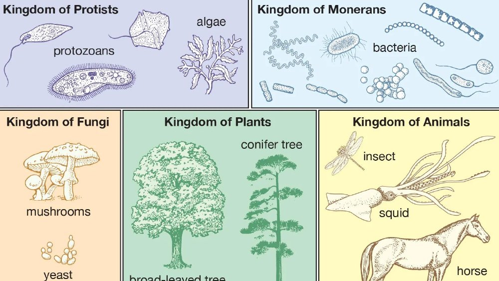
    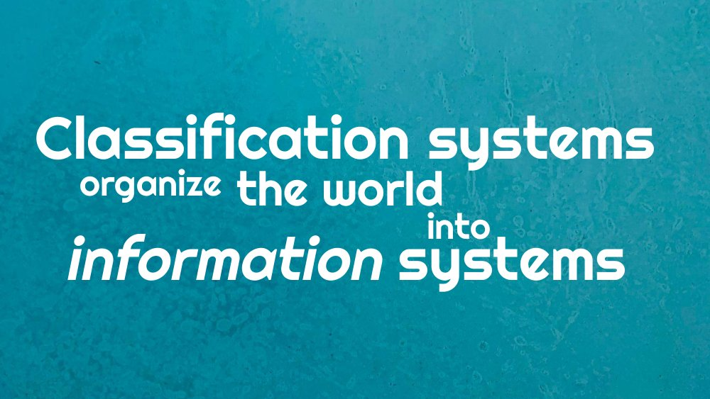
  </p>

- **An information system has five parts:** hardware, software, data, people, and process. Computers are one way to fill those parts in. They are not the only way, and not the first.

  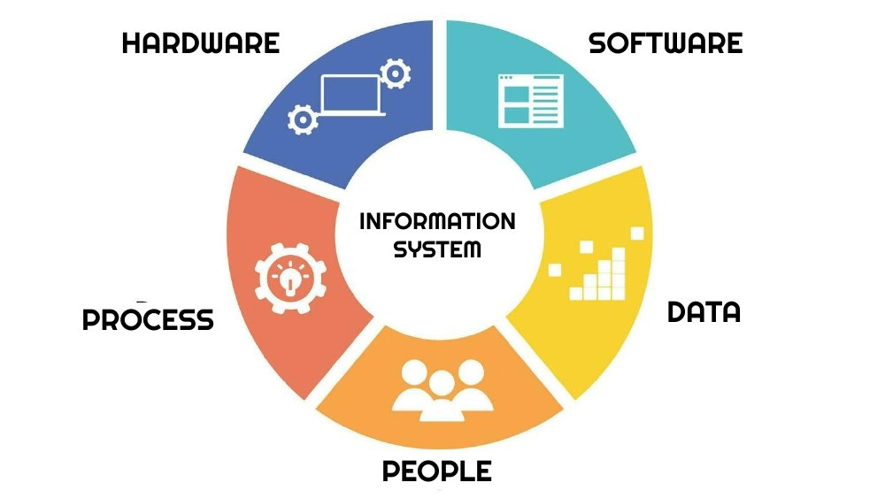

- **Indigenous information systems** fill the same five parts with different things:
  - *Hardware:* the land, ancestral landscapes, material artifacts
  - *Software:* customary law, ceremonial cycles, seasonal indicators
  - *Data:* oral histories, songlines, metaphors, traditional ecological knowledge
  - *People:* elders, knowledge keepers, clans
  - *Process:* lineage rights, gender-specific knowledge, initiations, intergenerational apprenticeship, communal gathering


  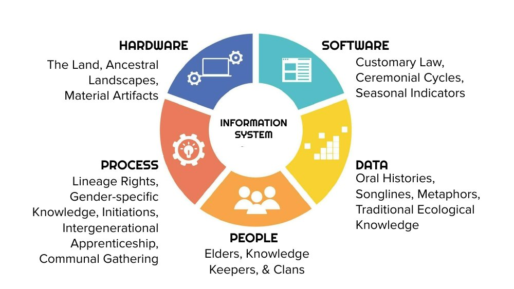

- **Examples from the lecture:**
  - **Songlines** (Aboriginal Australia): routes across the land that hold knowledge in song, story, and painting. The land itself is the storage medium.
  - **Wampum belts** (Haudenosaunee): woven shell beads that record agreements. The Hiawatha belt records the founding of the Haudenosaunee Confederacy, with each nation as a shape joined by a line.
  - **Quipu** (Inca): knotted cords that recorded numbers and records. The position and type of each knot carried meaning, a little like digits in place value.
  - **Polynesian wayfinding**: navigating open ocean using stars, swells, the sun, and birds, with the body (a hand held against the horizon) as a measuring tool.


  <p>
    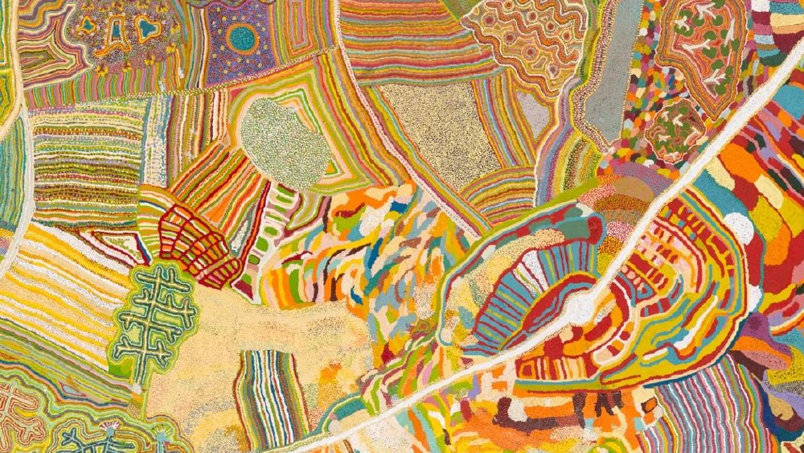
    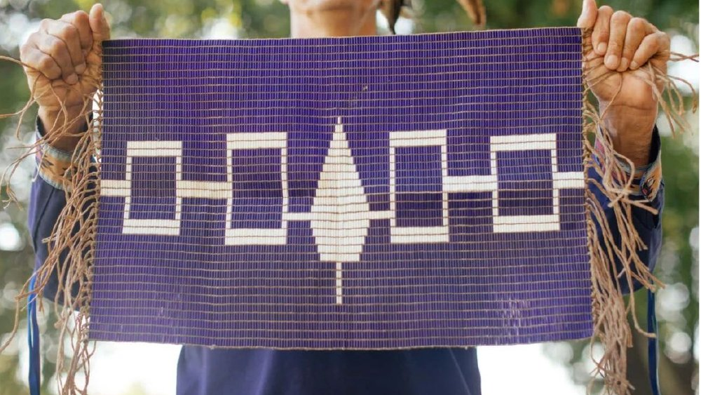
  </p>
  <p>
    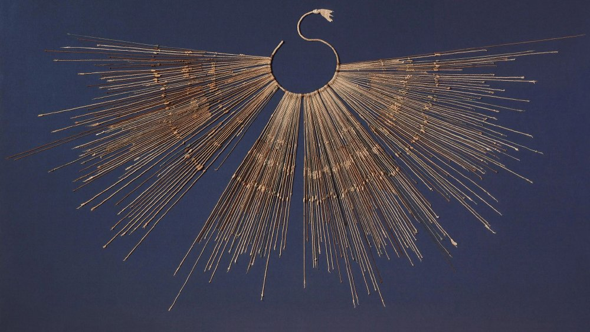
    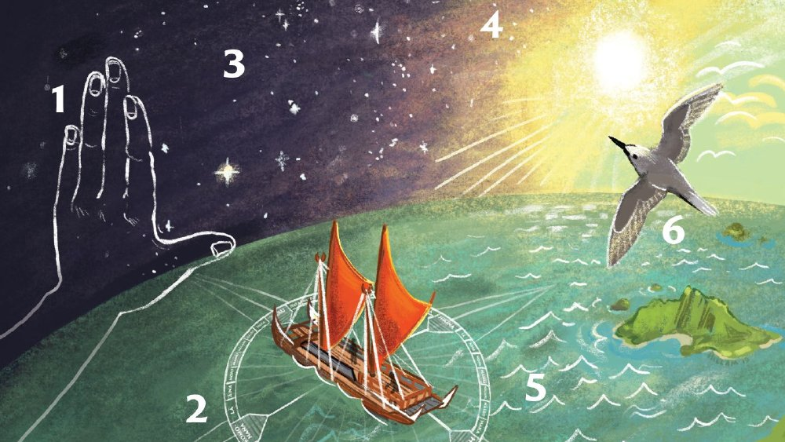
  </p>

- **Is the world really just one big data problem?** The lecture's question. Treating everything as data to be collected, sorted, and optimized is itself an origin story, and a recent one.

  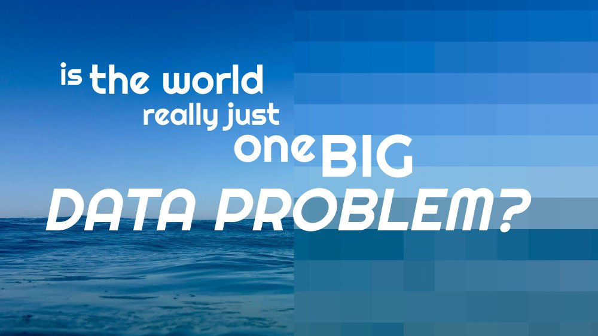

- **Two ways to write a program:**
  - **Procedural programming** (what we've done so far): a recipe of fixed steps that runs top to bottom. Clear, but it gets messy as the steps and shared global variables pile up.
  - **Object-oriented programming (OOP)**: the program is built from *objects*, each holding its own data and its own behaviors, which work together.


  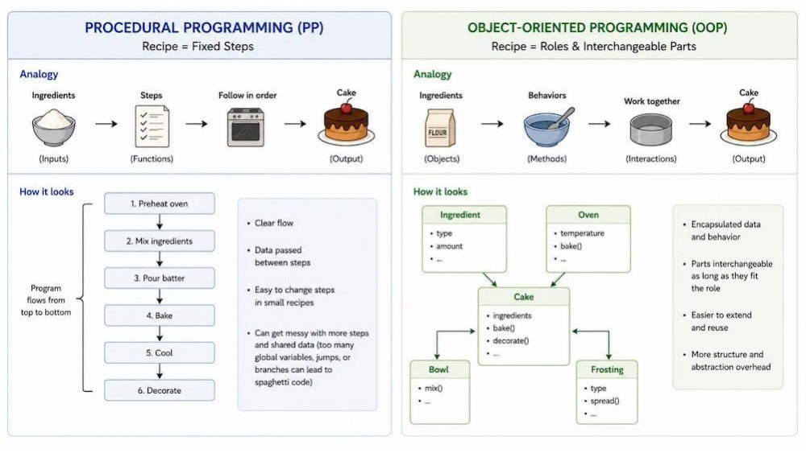

- **The four pillars of OOP:**
  - **Encapsulation** — an object keeps its own data and behaviors together, bundled up and contained.
  - **Abstraction** — you use an object without needing to know how it works inside.
  - **Inheritance** — a new class can start from an existing one and add to it, like nesting dolls.
  - **Polymorphism** — different objects can respond to the same command in their own ways.


  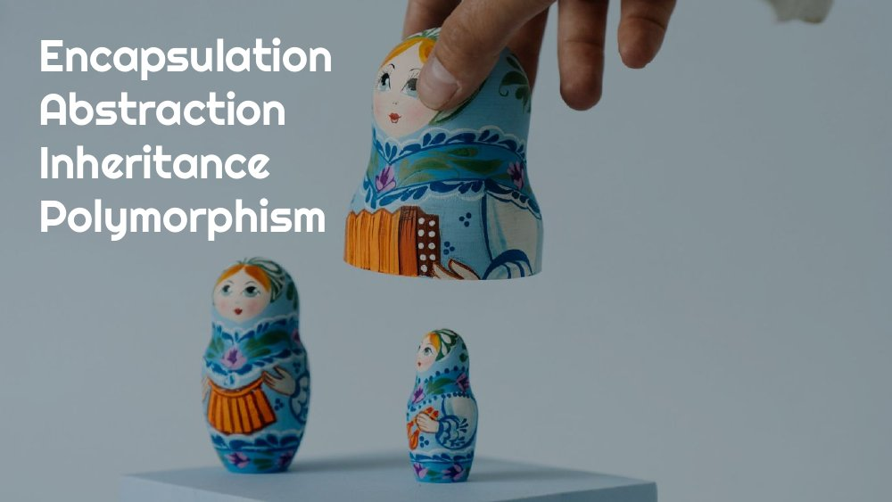

- **A class is a blueprint for creating objects.** The YT-1300 light freighter is the class; the *Millennium Falcon* is one object made from it. Every YT-1300 shares a design, but each one has its own values: its own pilot, its own dents, its own history.

  <p>
    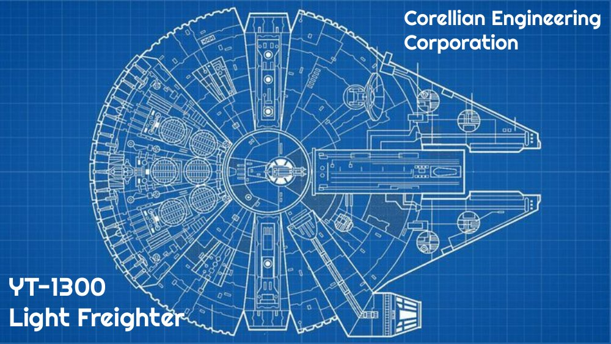
    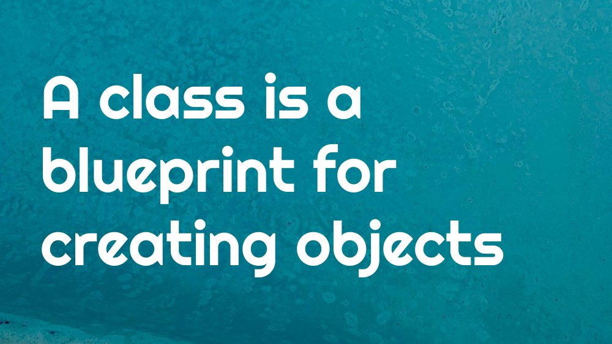
  </p>

- **A class is made of properties (attributes) and methods (behaviors).** The lecture's "Scoundrel" class had attributes (profession, resourcefulness, location, moral code) and behaviors (quick draw, evasive maneuvers). Three different characters, one class.

  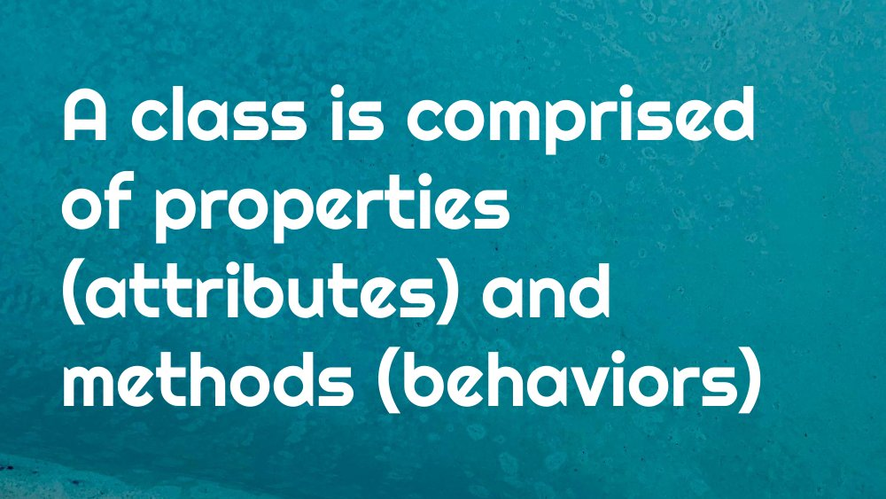

- **Who writes the origin story now?** The second half of the lecture looked at the "broligarchy": a small group of tech billionaires with outsized power over the systems we use, and the political philosophy some of them draw on (Curtis Yarvin, writing as Mencius Moldbug). Naomi Klein and Astra Taylor (*End Times Fascism*) and Gil Durán (*The Nerd Reich*) argue that some of the most powerful people in the world are preparing for an end of the world that they themselves are speeding up.
- **A different origin story.** The lecture ended at Glacier National Park and Blackfeet land: Chief Mountain, the Badger-Two Medicine area, the "Crown of the Continent," and Triple Divide Peak, one of the few places where water flows to three oceans (the Pacific, Hudson Bay, and the Gulf of Mexico). Everything is downstream of something.

  <p>
    
    
  </p>
  


### Discuss

Pick **one** prompt and write three or four sentences, then discuss.

1. The lecture showed the same five-part information system filled in two very different ways. Pick one Indigenous example (songlines, wampum, quipu, wayfinding) and describe what its "data" is and where it is stored. What would be lost if you converted it into a spreadsheet?
2. A class decides in advance what properties something has. The Scoundrel class has "Moral code: Fluid" but nothing for family, fear, or home. Pick a class you are subject to in real life (a student record, a social media profile, a medical form). What properties does it have? What did it leave out?
3. Encapsulation means keeping things separate and self-contained. Is that a neutral engineering choice, or does it carry a worldview? Where else in your life is "separate and self-contained" treated as the ideal?
4. Every piece of technology comes with an origin story told by the people who built it. Pick an app or company you use. What story does it tell about where it came from and what it is for? Who gets left out of that story?
5. "It's all downstream from here." What is upstream of the code you write (tools, companies, materials, energy, labor)? What is downstream of it?

## Reading Discussion: Relationality

Introduction ("Coming Up against the Nonrelational") of *Relationality: An Emergent Politics of Life Beyond the Human* (Bloomsbury, 2024) by Arturo Escobar, Michal Osterweil, and Kriti Sharma.

### Notes

- **The core argument:** many of today's crises (climate, energy, food, inequality, meaning) share one root assumption: **dualism**, the belief that things are fundamentally separate from each other. Mind from body, humans from nature, self from other, subject from object.
- **Relationality** is the alternative: the idea that everything that exists is radically **interdependent**. Things don't exist first and then form relationships; they come into being *through* their relationships.
- **"Nonrelational" living** is what happens when we act as if things are separate. The authors describe this as getting stuck in **toxic loops**: patterns that keep reproducing the damage they cause.
- **Relational weaves** are what the authors hope we can build instead: ways of living and designing made together with many others, human and nonhuman.
- **It's about design, too.** The authors are explicit that this changes how we design things, not just how we think. If design assumes separateness, it produces separateness.
- **Where the ideas come from:** the book draws on philosophy, biology, Indigenous knowledge, Buddhist thought, and social movements. Relational thinking is not new; many cultures have always worked this way. What's new is the urgency.

### Discuss

Get into groups of 3 or 4. Pick **one** prompt, then discuss.

1. Name one dualism you live with every day (online/offline, work/life, human/nature, user/designer). Where does it break down?
2. A class in code is a perfect example of something defined *as separate*: its own properties, its own methods, its own boundary. Could you write a class that is defined by its relationships instead? What would its properties be?
3. Find a "toxic loop" in a piece of technology you use. What keeps it going? What would break it?
4. How does this reading connect to Monday's lecture? Is the lecture's "one big data problem" a dualist way of seeing the world?
5. What is your Assignment #7 origin story in relation to? People, places, other beings, objects? How could your code show those relationships instead of just the main character?

[Back to top](#agenda)

---

## Assignment #7 Review

In groups of 3, each person shares their Part 1:

1. **Whose origin story** are you telling, and why?
2. **Who or what are the characters?** For each one, name two **properties** (what it *has*) and two **methods** (what it *does*). That's the start of a class.
3. **What relationships matter in your story?** Which characters affect each other?

We'll livecode a starting point for a few volunteers' characters together.

### Activity

1. **10 minutes:** translate your story into a narrative flow chart (Figma, Miro, paper, anything).
2. **10 minutes:** list the steps you'd take to code it up to a gray-box version.

<p>
  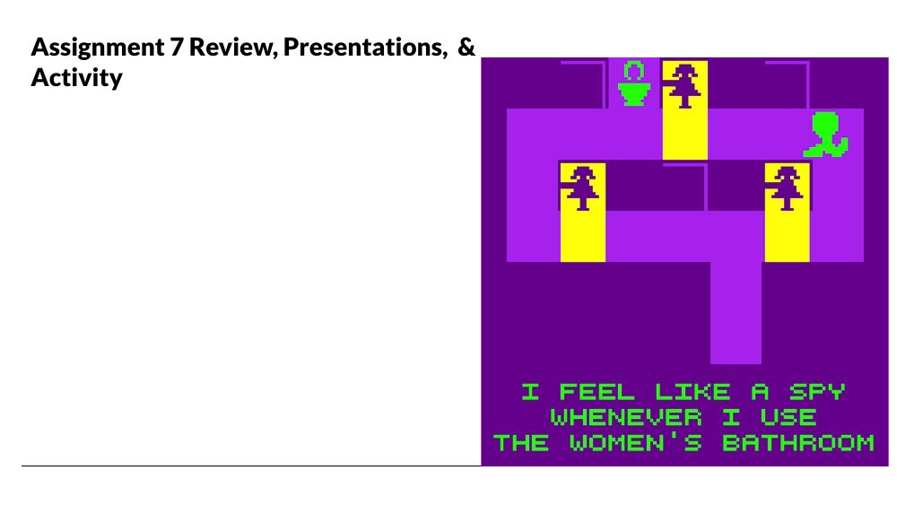
  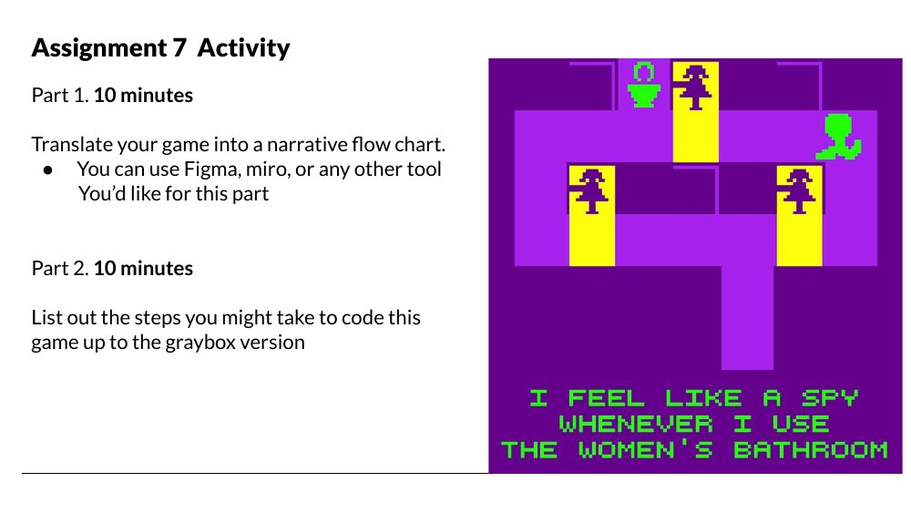
</p>

*Reference:* [Dys4ia](https://www.youtube.com/watch?v=a_NIZ0BJWW0) (2012) by Anna Anthropy, an autobiographical game built from short scenes.


[Back to top](#agenda)

---

## Tutorial: Classes & Objects

### Review: arrays

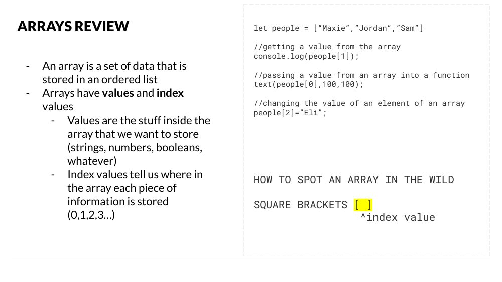

### In Class 9 Practice 1

Make a new sketch titled "In Class 9 Practice 1". Use a 600 × 600 canvas.

Using what you learned last week (parallel arrays), make **three bubbles**:

- Each bubble has an x, a y, and a radius.
- Every frame, each bubble wiggles a little in a random direction (`random(-1, 1)`).
- Draw each one as a white outline on a black background.

<details>
<summary>One possible solution</summary>

```js
let xs = [200, 100, 450];
let ys = [200, 150, 400];
let rs = [40, 20, 60];

function setup() {
  createCanvas(600, 600);
}

function draw() {
  background(0);
  stroke(255);
  strokeWeight(2);
  noFill();

  for (let i = 0; i < xs.length; i++) {
    xs[i] += random(-1, 1);
    ys[i] += random(-1, 1);
    circle(xs[i], ys[i], rs[i] * 2);
  }
}
```

</details>

This works. But a single bubble is spread across three separate arrays, and nothing in the code says that `xs[2]`, `ys[2]`, and `rs[2]` belong together. Add a color, a speed, and a name, and you have six arrays to keep in sync. A **class** fixes this by keeping everything about one bubble in one place.

### What is an object?

An **object** is a data structure like an array, but instead of `[]` it uses `{}`. Instead of numbered slots, it stores data as **key-value pairs**: each piece of data has a name. Objects are useful when the data has no natural order, or when one thing has several different kinds of data that belong together.

| New terms | |
| --- | --- |
| object | a data structure that holds variables as key-value pairs; uses `{}`; unordered |
| key | the **property** name we use to get a piece of data out of the object |
| value | the data that is stored, like an **element** in an array |

#### Declaring an object

```js
let myNewObject = {};
```

#### Initializing an object with values

One object can hold strings, numbers, and booleans side by side, all describing the same thing.

```js
let myPet = {
  name: "Oreo",
  age: 13,
  isCat: true
};
```

#### Retrieving a value with its property

Objects are unordered, so there's no index. Instead, use the object name + `.` + the property name.

```js
print(myPet.name);   // "Oreo"
print(myPet.age);    // 13
print(myPet.isCat);  // true

// square brackets also work, with the key as a string
print(myPet["name"]); // "Oreo"
```

You've already been using dot notation: `.length` is a property of an array.

#### Adding and changing properties

Use a new property name and it gets added. Use an existing one and it gets changed.

```js
let triangle = {
  a: 10,
  b: 15
};

triangle.c = 20;  // adds .c: now {a: 10, b: 15, c: 20}
triangle.a = 12;  // changes .a: now {a: 12, b: 15, c: 20}
```

#### Objects and loops

Arrays have `for...of`. Objects have their own loop, `for...in`, which goes through every **key**:

```js
let myPet = { name: "Oreo", age: 13, isCat: true };

for (let key in myPet) {
  print(key + ": " + myPet[key]);
}

// "name: Oreo"
// "age: 13"
// "isCat: true"
```

#### Back to the bubble

Here's one bubble as an object:

```js
let bubble = { x: 200, y: 200, r: 40 };

bubble.x;       // 200
bubble.r;       // 40
bubble.x += 5;  // now 205
```

Everything about this bubble lives under one name. But what if you want 50 bubbles? Typing 50 of these is repetition, and last week's rule applies: repetition wants a tool. That tool is a class.

<p>
  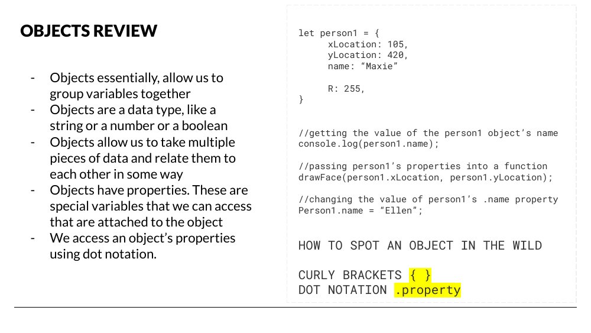
  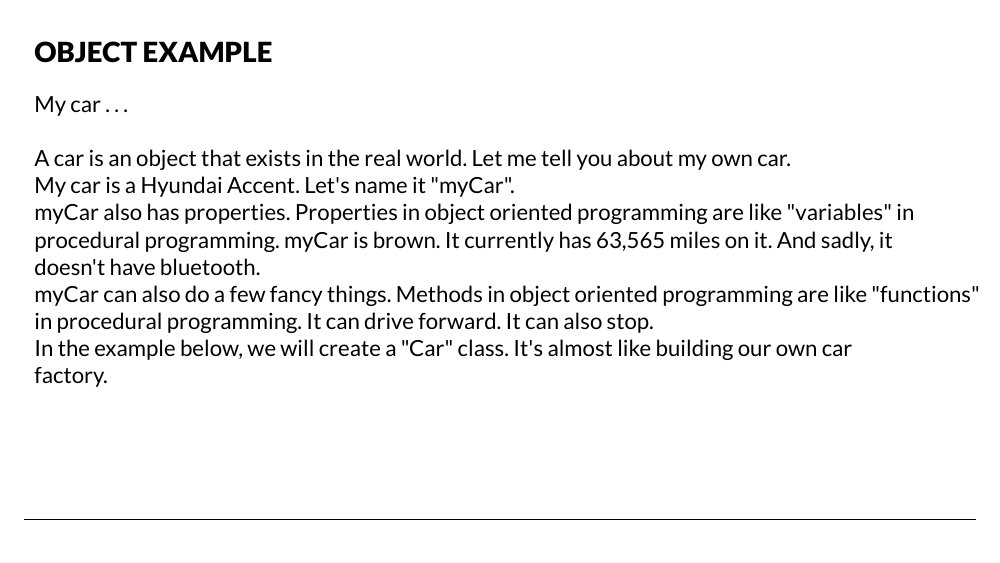
</p>


### What is a class?

A **class is a blueprint for creating objects.** It describes what every object of that kind *has* (properties) and what it *does* (methods). It doesn't make anything by itself, just like a recipe card doesn't cook dinner and the YT-1300 blueprint isn't a ship.

<p>
  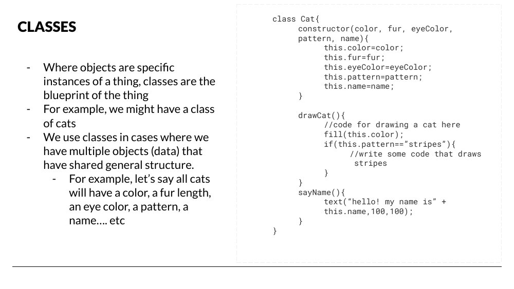
  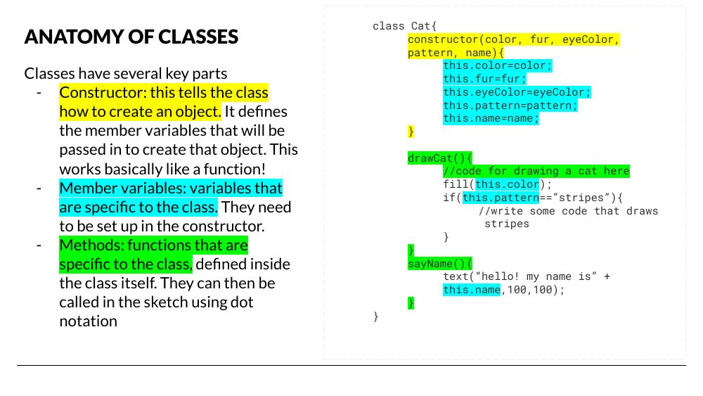
</p>


| New terms | |
| --- | --- |
| class | a blueprint for creating many similar objects. Unlike a plain object, a class can hold **functions** too |
| instance | one object made from a class, using the keyword `new` |
| constructor | a function that runs automatically every time you make an instance |
| `this` | the keyword a class uses to refer to the object being made or used |

#### Building a class, one piece at a time

**1. Declare the class.** Classes are like stamps for objects.

```js
class MyNewClass {

}
```

**2. Add a constructor.** It runs every time you make an instance.

```js
class MyNewClass {
  constructor() {

  }
}
```

**3. Make an instance with `new`.**

```js
function setup() {
  let myClassInstance = new MyNewClass();
}
```

**4. Add properties with `this`.** Right now `myClassInstance` is an empty object. To give it data, set properties with `this` inside the constructor:

```js
class MyNewClass {
  constructor() {
    this.x = 50;
    this.y = 100;
  }
}

let myClassInstance = new MyNewClass();
myClassInstance.x;  // 50
myClassInstance.y;  // 100
```

**5. Add parameters,** so each instance can start with different values:

```js
class MyNewClass {
  constructor(xPos, yPos) {
    this.x = xPos;
    this.y = yPos;
    this.size = 100;
  }
}

let myClassInstance = new MyNewClass(10, 20);
myClassInstance.x;    // 10
myClassInstance.y;    // 20
myClassInstance.size; // 100
```

**6. Add methods.** This is what makes a class more than an object: functions that live inside it.

```js
class MyNewClass {
  constructor(xPos, yPos) {
    this.x = xPos;
    this.y = yPos;
    this.size = 100;
  }

  move() {
    this.x++;
  }
}

let myClassInstance = new MyNewClass(10, 20);
myClassInstance.move();  // now myClassInstance.x is 11
```

#### Putting it together: the Bubble

```js
class Bubble {
  // 1. The setup: runs once when new Bubble() is called
  constructor(tempX, tempY, tempR) {
    this.x = tempX;
    this.y = tempY;
    this.r = tempR;
  }

  // 2. Behavior: how the bubble moves
  move() {
    this.x += random(-1, 1);
    this.y += random(-1, 1);
  }

  // 3. Appearance: how the bubble looks
  show() {
    stroke(255);
    strokeWeight(2);
    noFill();
    ellipse(this.x, this.y, this.r * 2);
  }
}
```

The parts:

| Part | In the example | What it does |
| --- | --- | --- |
| `class Bubble` | the name | class names start with a **capital letter** by convention |
| `constructor()` | `constructor(tempX, tempY, tempR)` | a special function that runs **once**, when a new object is made; it sets up the properties |
| `this.x` | `this.x = tempX;` | a **property**: a variable that belongs to *this one* object |
| methods | `move()`, `show()` | functions that belong to the class; every object gets them |

Two things look different from the functions you've written before:

- **No `function` keyword** inside a class. Write `move() { }`, not `function move() { }`.
- **No commas** between methods.

### Try it: a definitions exercise

Pick your favorite physical object.

1. Describe it using only functions. Then describe it as a class with properties and methods. What's different?
2. Write it in code: build the class, give it a method that does something, and make one with `new`.

<p>
  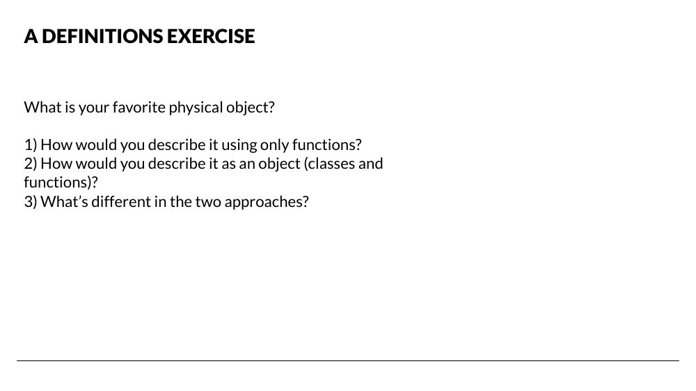
  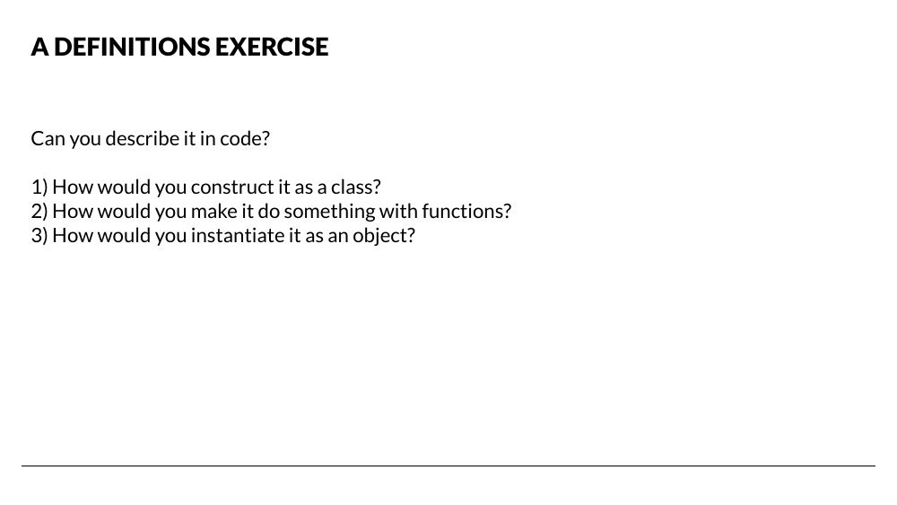
</p>


### `this`

`this` means **"the object I'm inside right now."** When bubble 1 runs `move()`, `this.x` is bubble 1's x. When bubble 2 runs the same `move()`, `this.x` is bubble 2's x. One method, written once, and each object uses its own data.

Forgetting `this` is the most common bug this week:

```js
move() {
  x += random(-1, 1);       // error: x is not defined
  this.x += random(-1, 1);  // correct
}
```

### Making objects with `new`

The class is the blueprint. `new` builds an object from it. The arguments go to the constructor.

```js
let bubble1; // declare globally, like any variable
let bubble2;

function setup() {
  createCanvas(400, 400);

  // create two separate objects from the Bubble blueprint
  bubble1 = new Bubble(200, 200, 40);
  bubble2 = new Bubble(100, 150, 20);
}
```

Each object made from a class is called an **instance** of that class.

<p>
  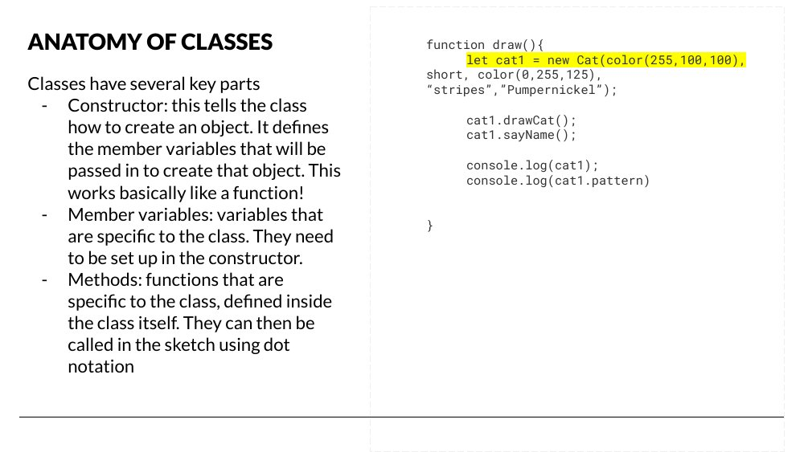
  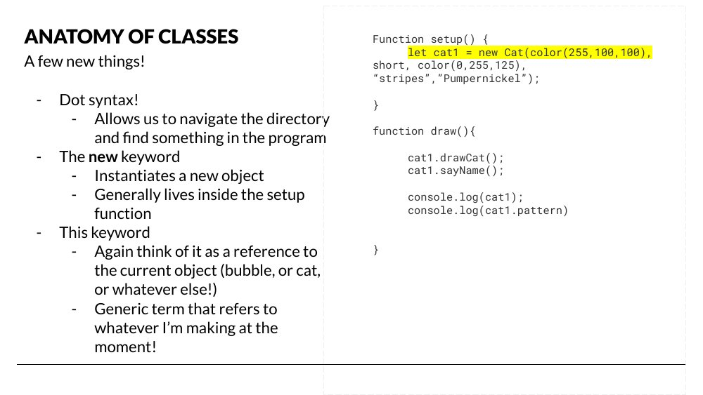
</p>


### Calling methods

Put a `.` after the object's name, then the method:

```js
function draw() {
  background(0);

  // call the methods belonging to each independent object
  bubble1.move();
  bubble1.show();

  bubble2.move();
  bubble2.show();
}
```

The whole Bubble example from lecture, in order:

<p>
  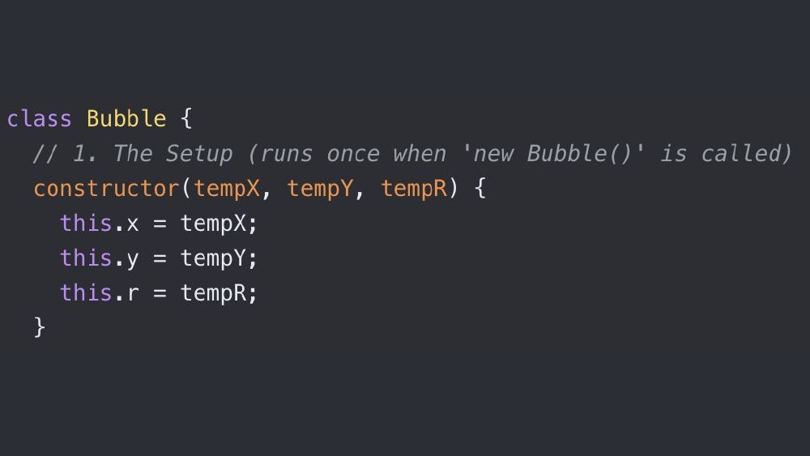
  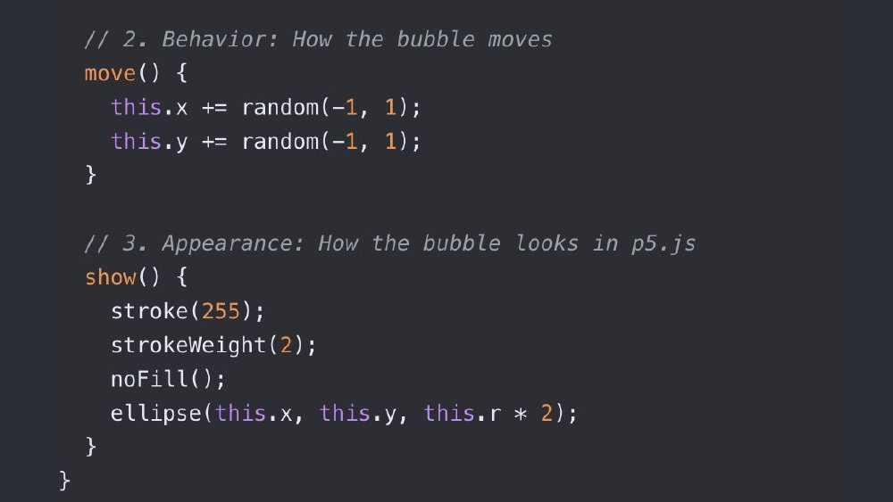
</p>
<p>
  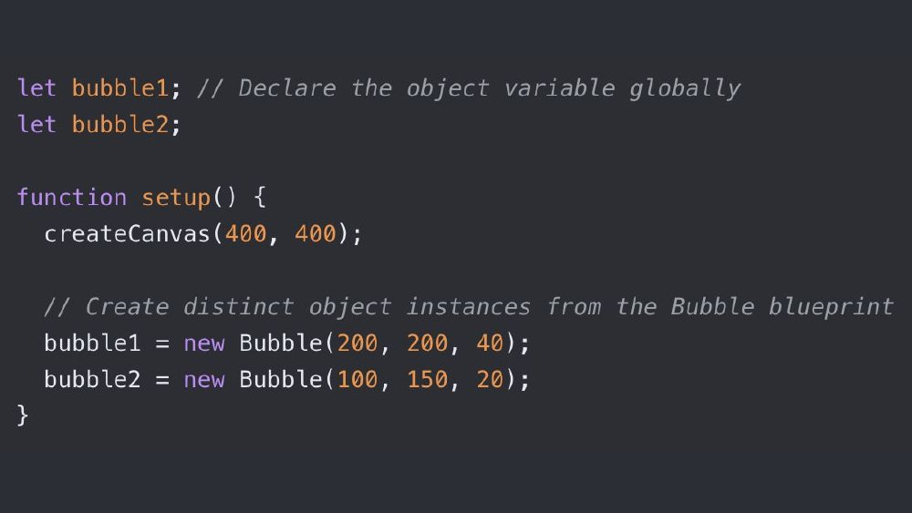
  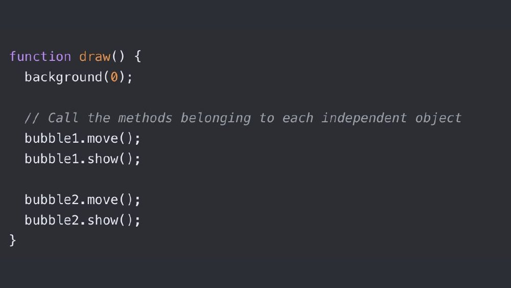
</p>

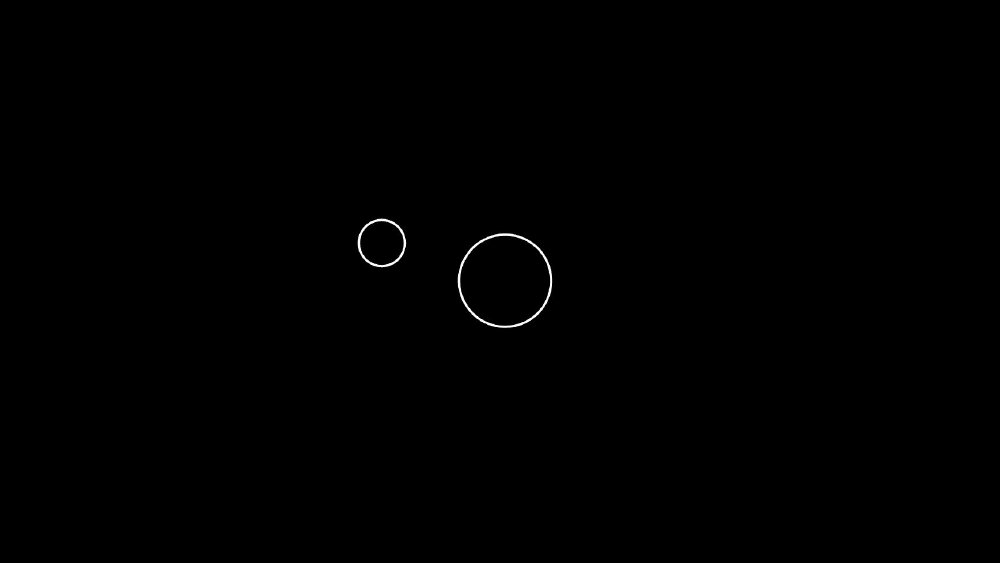

What happens at `bubble1.move()`: `draw()` pauses → jumps into the `move()` method with `this` set to `bubble1` → changes `bubble1.x` and `bubble1.y` → returns to the next line of `draw()`. Same as calling a function, except the method always knows which object it's working on.

You can also read or change an object's properties directly from outside:

```js
bubble1.r = 80;              // make bubble 1 bigger
console.log(bubble2.x);      // where is bubble 2 right now?
```

### Where does the class go?

Anywhere outside `setup()` and `draw()`. Most people put it at the bottom of `sketch.js`, or in its own file:

1. In the p5 editor, click the `>` arrow next to the file name to open the sidebar, then **+ → Create file**, and name it `bubble.js`.
2. Move the whole class into that file.
3. In `index.html`, add `<script src="bubble.js"></script>` on the line **above** `<script src="sketch.js"></script>`.

Separate files are optional this week, but they'll help with Assignment #7.

### In Class 9 Practice 2

Duplicate / Fork "In Class 9 Practice 1" and rename it "In Class 9 Practice 2".

- Replace the three arrays with a `Bubble` class.
- Make three bubble objects with `new`, and call `move()` and `show()` on each in `draw()`.

<details>
<summary>One possible solution</summary>

```js
let bubble1;
let bubble2;
let bubble3;

function setup() {
  createCanvas(600, 600);
  bubble1 = new Bubble(200, 200, 40);
  bubble2 = new Bubble(100, 150, 20);
  bubble3 = new Bubble(450, 400, 60);
}

function draw() {
  background(0);

  bubble1.move();
  bubble1.show();
  bubble2.move();
  bubble2.show();
  bubble3.move();
  bubble3.show();
}

class Bubble {
  constructor(tempX, tempY, tempR) {
    this.x = tempX;
    this.y = tempY;
    this.r = tempR;
  }

  move() {
    this.x += random(-1, 1);
    this.y += random(-1, 1);
  }

  show() {
    stroke(255);
    strokeWeight(2);
    noFill();
    ellipse(this.x, this.y, this.r * 2);
  }
}
```

</details>

Now add a property: give each bubble its own color. You'll need to change the constructor (a fourth parameter and a `this.c`), `show()` (use `this.c` in `stroke()`), and the three `new` calls. Notice that `draw()` doesn't change at all.

[Back to top](#agenda)

---

## Walkthrough: Arrays of Objects

Every sketch below is complete. Paste it into the [p5 editor](https://editor.p5js.org/), run it, and do the "Try it" before moving on.

### 1. An array of objects

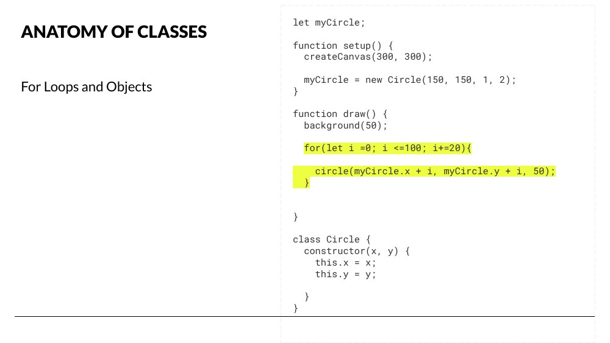

`bubble1`, `bubble2`, `bubble3` is the same repetition problem as Week 8's `mon`, `tue`, `wed`. Same fix: an array. Except now each slot holds a whole object instead of a number.

```js
let bubbles = [];

function setup() {
  createCanvas(600, 600);

  for (let i = 0; i < 20; i++) {
    bubbles.push(new Bubble(random(width), random(height), random(10, 50)));
  }
}

function draw() {
  background(0);

  for (let i = 0; i < bubbles.length; i++) {
    bubbles[i].move();
    bubbles[i].show();
  }
}

class Bubble {
  constructor(tempX, tempY, tempR) {
    this.x = tempX;
    this.y = tempY;
    this.r = tempR;
  }

  move() {
    this.x += random(-1, 1);
    this.y += random(-1, 1);
  }

  show() {
    stroke(255);
    strokeWeight(2);
    noFill();
    ellipse(this.x, this.y, this.r * 2);
  }
}
```

Read `bubbles[i].move()` from left to right: the array → item number `i` (a Bubble) → that bubble's `move()` method.

Compare it to last week:

| Week 8: parallel arrays | Week 9: array of objects |
| --- | --- |
| `xs[i]`, `ys[i]`, `rs[i]` | `bubbles[i].x`, `bubbles[i].y`, `bubbles[i].r` |
| one array per property | one array, one object per slot |
| easy to get out of sync | everything about one bubble stays together |

**Try it**

- Change `20` to `200`. Nothing else needs to change.
- Use `for...of` instead: `for (let b of bubbles) { b.move(); b.show(); }`

### 2. Make one on every click

`push()` works with objects too.

```js
let bubbles = [];

function setup() {
  createCanvas(600, 600);
}

function mousePressed() {
  bubbles.push(new Bubble(mouseX, mouseY, random(10, 50)));
}

function draw() {
  background(0);

  for (let b of bubbles) {
    b.move();
    b.show();
  }

  fill(255);
  noStroke();
  text(bubbles.length + " bubbles", 20, 30);
}

class Bubble {
  constructor(tempX, tempY, tempR) {
    this.x = tempX;
    this.y = tempY;
    this.r = tempR;
  }

  move() {
    this.x += random(-1, 1);
    this.y += random(-1, 1);
  }

  show() {
    stroke(255);
    strokeWeight(2);
    noFill();
    ellipse(this.x, this.y, this.r * 2);
  }
}
```

### 3. A method that answers a question

Methods can `return` values, just like functions. This one answers "is this point inside me?" Then each bubble can change its own color when the mouse is over it.

```js
let bubbles = [];

function setup() {
  createCanvas(600, 600);
  for (let i = 0; i < 20; i++) {
    bubbles.push(new Bubble(random(width), random(height), random(20, 60)));
  }
}

function draw() {
  background(0);

  for (let b of bubbles) {
    b.move();
    b.show();
  }
}

class Bubble {
  constructor(tempX, tempY, tempR) {
    this.x = tempX;
    this.y = tempY;
    this.r = tempR;
  }

  contains(px, py) {
    return dist(px, py, this.x, this.y) < this.r;
  }

  move() {
    this.x += random(-1, 1);
    this.y += random(-1, 1);
  }

  show() {
    stroke(255);
    strokeWeight(2);
    if (this.contains(mouseX, mouseY)) {
      fill(120, 0, 120);
    } else {
      noFill();
    }
    ellipse(this.x, this.y, this.r * 2);
  }
}
```

Notice `this.contains(...)`: a method calling another method of the *same* object also needs `this`.

### 4. Removing objects: pop the bubble

To remove an object, use `.splice(index, 1)` from Week 8. Loop **backwards** when removing, because removing an item shifts everything after it down one slot. Counting down means you never skip one.

```js
let bubbles = [];

function setup() {
  createCanvas(600, 600);
  for (let i = 0; i < 30; i++) {
    bubbles.push(new Bubble(random(width), random(height), random(20, 60)));
  }
}

function mousePressed() {
  for (let i = bubbles.length - 1; i >= 0; i--) {
    if (bubbles[i].contains(mouseX, mouseY)) {
      bubbles.splice(i, 1);
    }
  }
}

function draw() {
  background(0);
  for (let b of bubbles) {
    b.move();
    b.show();
  }
}

class Bubble {
  constructor(tempX, tempY, tempR) {
    this.x = tempX;
    this.y = tempY;
    this.r = tempR;
  }

  contains(px, py) {
    return dist(px, py, this.x, this.y) < this.r;
  }

  move() {
    this.x += random(-1, 1);
    this.y += random(-1, 1);
  }

  show() {
    stroke(255);
    strokeWeight(2);
    noFill();
    ellipse(this.x, this.y, this.r * 2);
  }
}
```

**Try it**

- Add a `keyPressed()` that refills the array with 30 new bubbles.
- Instead of removing a clicked bubble, make it bigger.

### 5. Objects that relate to each other

So far every bubble ignores every other bubble. Each one is fully encapsulated. But objects can know about each other. Here, each bubble checks every other bubble, and lights up if it is touching one. This is a nested loop over an array of objects.

```js
let bubbles = [];

function setup() {
  createCanvas(600, 600);
  for (let i = 0; i < 25; i++) {
    bubbles.push(new Bubble(random(width), random(height), random(20, 50)));
  }
}

function draw() {
  background(0);

  for (let b of bubbles) {
    b.move();
    b.touching = false;              // assume alone...
    for (let other of bubbles) {
      if (b != other && b.intersects(other)) {
        b.touching = true;           // ...until proven otherwise
      }
    }
    b.show();
  }
}

class Bubble {
  constructor(tempX, tempY, tempR) {
    this.x = tempX;
    this.y = tempY;
    this.r = tempR;
    this.touching = false;
  }

  intersects(other) {
    return dist(this.x, this.y, other.x, other.y) < this.r + other.r;
  }

  move() {
    this.x += random(-2, 2);
    this.y += random(-2, 2);
  }

  show() {
    stroke(255);
    strokeWeight(2);
    if (this.touching) {
      fill(255, 221, 87, 150);
    } else {
      noFill();
    }
    ellipse(this.x, this.y, this.r * 2);
  }
}
```

`intersects(other)` takes a whole object as its argument. Two circles touch when the distance between their centers is less than their two radii added together.

**Try it**

- Make touching bubbles grow a little each frame they're touching.
- What would it look like if a bubble's color came from *how many* others it was touching?
- Think back to the reading: which version of this sketch is more "relational"? What would a bubble look like if it were defined entirely by its relationships?

### 6. When classes go wrong

**Forgot `this`.** `x is not defined` inside a method almost always means you wrote `x` instead of `this.x`.

**Forgot `new`.** `bubble1 = Bubble(200, 200, 40);` throws an error. Classes need `new`.

**Used `function` inside the class.** `function move() { }` inside a class is a syntax error. Methods are just `move() { }`.

**Forgot the parentheses.** `bubble1.show;` does nothing; it names the method without calling it. `bubble1.show();` runs it.

**Made the object before `setup()`.** `let b = new Bubble(random(width), ...)` at the very top of the sketch fails, because p5 functions like `random()` and `width` don't exist yet. Declare at the top, create inside `setup()`.

**Capitalization.** `new bubble()` is not `new Bubble()`. Class names are case-sensitive.

[Back to top](#agenda)

---

## Group Exercise: Fruit Escape

The fruit in the bowl does not want to be eaten. Your hand (the mouse) reaches in; the fruit runs away.

Work in groups of 3 or 4, in one shared sketch. Make a new sketch titled "Fruit Escape" and share the link with your group.

### The starter

```js
// FRUIT ESCAPE
// The fruit does not want to be eaten.
// Work through the steps in order. Run your sketch after each one.

let fruits = [];

function setup() {
  createCanvas(600, 600);

  for (let i = 0; i < 12; i++) {
    let x = random(200, 400);
    let y = random(250, 350);
    fruits.push(new Fruit(x, y, 40, color(230, 60, 60)));
  }
}

function draw() {
  background(250, 240, 220);

  // the bowl
  noStroke();
  fill(200, 170, 130);
  arc(300, 300, 300, 200, 0, PI);

  for (let i = 0; i < fruits.length; i++) {
    fruits[i].move();
    fruits[i].show();
  }

  // the hand
  fill(255, 200, 170, 150);
  circle(mouseX, mouseY, 50);
}

class Fruit {
  constructor(x, y, size, c) {
    this.x = x;
    this.y = y;
    this.size = size;
    this.c = c;
  }

  move() {
    // TODO: step 1 and step 2
  }

  show() {
    noStroke();
    fill(this.c);
    circle(this.x, this.y, this.size);
  }
}
```

### Steps

1. **Fidget.** In `move()`, make each fruit wiggle a little every frame, like the bubbles. (Hint: `this.x += random(-1, 1);`)
2. **Escape.** If the hand gets within 100 pixels of a fruit, the fruit moves *away* from it. (Hint: `dist(this.x, this.y, mouseX, mouseY)` tells you how close the hand is. `this.x - mouseX` is positive when the fruit is to the right of the hand, so adding a small piece of it pushes the fruit further right.)
3. **Stay on the table.** Use `constrain()` so fruit can't leave the canvas.
4. **Everyone brings a fruit.** Add a `kind` property to the constructor (`"apple"`, `"banana"`, `"grape"`...). Each person in the group owns one kind and writes its branch in `show()` with `if` / `else if`. Each kind should also escape a little differently: add a `speed` property, so grapes are quick and melons are slow.
   - **The contract:** agree as a group on the constructor's parameters *before* anyone starts, the same way the exquisite corpse agreed on where the pieces join. Don't edit anyone else's branch.
5. **Caught.** Add a `caught(px, py)` method that returns `true` if a point is inside the fruit. In `mousePressed()`, loop backwards through `fruits` and `splice()` out any fruit you clicked. Show how many are left.

*Stretch (pick one):*

- **Safety in numbers.** A fruit that is touching another fruit doesn't run (use walkthrough part 5). Fruit that stick together are harder to grab.
- **Freedom.** A fruit that reaches the edge of the canvas has escaped for good. Remove it and count the escapees. Then show a different end screen depending on who won: you or the fruit.
- **Ripeness.** Each fruit has a `ripe` property that counts down over time and changes its color. Ripe fruit gets slower.

*Share-out:* one group projects their sketch. The room guesses which group member wrote which fruit.

<details>
<summary>One possible solution (steps 1–5)</summary>

```js
let fruits = [];
let kinds = ["apple", "grape", "lemon"];

function setup() {
  createCanvas(600, 600);

  for (let i = 0; i < 12; i++) {
    let x = random(200, 400);
    let y = random(250, 350);
    let kind = kinds[i % kinds.length];
    fruits.push(new Fruit(x, y, kind));
  }
}

function mousePressed() {
  for (let i = fruits.length - 1; i >= 0; i--) {
    if (fruits[i].caught(mouseX, mouseY)) {
      fruits.splice(i, 1);
    }
  }
}

function draw() {
  background(250, 240, 220);

  noStroke();
  fill(200, 170, 130);
  arc(300, 300, 300, 200, 0, PI);

  for (let i = 0; i < fruits.length; i++) {
    fruits[i].move();
    fruits[i].show();
  }

  fill(255, 200, 170, 150);
  circle(mouseX, mouseY, 50);

  fill(0);
  text(fruits.length + " fruit left", 20, 30);
}

class Fruit {
  constructor(x, y, kind) {
    this.x = x;
    this.y = y;
    this.kind = kind;

    if (kind == "apple") {
      this.size = 45;
      this.speed = 0.04;
    } else if (kind == "grape") {
      this.size = 20;
      this.speed = 0.1;
    } else {
      this.size = 35;
      this.speed = 0.06;
    }
  }

  caught(px, py) {
    return dist(px, py, this.x, this.y) < this.size / 2;
  }

  move() {
    // 1. fidget
    this.x += random(-1, 1);
    this.y += random(-1, 1);

    // 2. escape
    let d = dist(this.x, this.y, mouseX, mouseY);
    if (d < 100) {
      this.x += (this.x - mouseX) * this.speed;
      this.y += (this.y - mouseY) * this.speed;
    }

    // 3. stay on the table
    this.x = constrain(this.x, 0, width);
    this.y = constrain(this.y, 0, height);
  }

  show() {
    noStroke();
    if (this.kind == "apple") {
      fill(230, 60, 60);
      circle(this.x, this.y, this.size);
      fill(80, 160, 60);
      ellipse(this.x + 6, this.y - this.size / 2, 12, 6); // leaf
    } else if (this.kind == "grape") {
      fill(120, 60, 150);
      circle(this.x, this.y, this.size);
    } else {
      fill(250, 220, 70);
      ellipse(this.x, this.y, this.size * 1.3, this.size);
    }
  }
}
```

</details>

[Back to top](#agenda)

---

## Midterm Course Feedback

We're halfway through the semester. Please take 10 minutes to fill out the anonymous midterm feedback form (link shared in class). Be honest: what's working, what isn't, what's confusing, what you'd like more or less of. It changes what we do for the rest of the semester.

## Assignment #7 [Part 2]

Origin Stories, Part 2. Due Thursday 10/29.

Keep developing your Part 1 based on today's review. As you work, think in classes:

1. Which characters or things in your story should be a **class**? What are their properties and methods?
2. Which ones will there be **many** of? Those belong in an array of objects.
3. Which **relationships** between objects matter, and how will your code show them (touching, following, avoiding, changing each other)?

Submit to the CC Lab Canvas assignment and add it to your portfolio.

## Extra Review Materials

- [Classes & Objects](https://www.youtube.com/watch?v=JN0u2oW3RA0&list=PLhlnwyfMOozUbqlyB-Q2HkXdeBM1-T-sT&index=26)
- [Arrays of Objects](https://www.youtube.com/watch?v=QHj6Vs56J54&list=PLhlnwyfMOozUbqlyB-Q2HkXdeBM1-T-sT&index=27)
- Coding Train [6.1: Classes in JavaScript with ES6](https://www.youtube.com/watch?v=T-HGdc8L-7w)
- Coding Train [7.3: Arrays of Objects](https://www.youtube.com/watch?v=fBqaA7zRO58)
- Coding Train [7.6: Object Communication Part 1](https://youtu.be/W1-ej3Wu5zg?list=PLRqwX-V7Uu6Zy51Q-x9tMWIv9cueOFTFA)
- Coding Train [7.7: Object Communication Part 2](https://youtu.be/5Q9cA0REztY?list=PLRqwX-V7Uu6Zy51Q-x9tMWIv9cueOFTFA)
- Coding Train [7.8: Objects and Images](https://youtu.be/i2C1hrJMwz0?list=PLRqwX-V7Uu6Zy51Q-x9tMWIv9cueOFTFA)
- p5.js Reference [object](https://p5js.org/reference/p5/object/)
- p5.js Reference [class](https://p5js.org/reference/p5/class/)
- MDN [Classes](https://developer.mozilla.org/en-US/docs/Web/JavaScript/Reference/Classes)
- MDN [this](https://developer.mozilla.org/en-US/docs/Web/JavaScript/Reference/Operators/this)

## Coding Glossary

| Term | Meaning |
| --- | --- |
| object | a data structure that holds variables as key-value pairs, using `{}`; unordered |
| key | the property name used to get a value out of an object: `myPet.name` |
| value | the data stored under a key |
| `for...in` | a loop that goes through every key of an object |
| class | a blueprint for creating objects: `class Bubble { ... }` |
| instance | one object made from a class |
| `new` | makes a new object from a class: `new Bubble(200, 200, 40)` |
| constructor | the special method that runs once when an object is made; sets up its properties |
| property / attribute | a variable that belongs to an object: `this.x` |
| method / behavior | a function that belongs to a class: `move()`, `show()` |
| `this` | "the object I'm inside right now" |
| dot operator `.` | reaches inside an object: `bubble1.x`, `bubble1.show()` |
| array of objects | an array where every slot holds an object: `bubbles[i].show()` |
| procedural programming | a program written as a fixed sequence of steps |
| object-oriented programming (OOP) | a program built from objects that hold their own data and behaviors |
| encapsulation | keeping an object's data and behaviors bundled together |
| abstraction | using an object without needing to know how it works inside |
| inheritance | making a new class that starts from an existing one |
| polymorphism | different objects responding to the same command in their own ways |

[Back to top](#agenda)