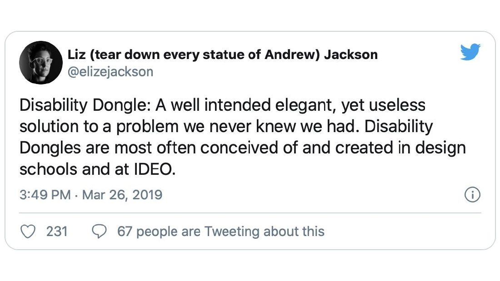
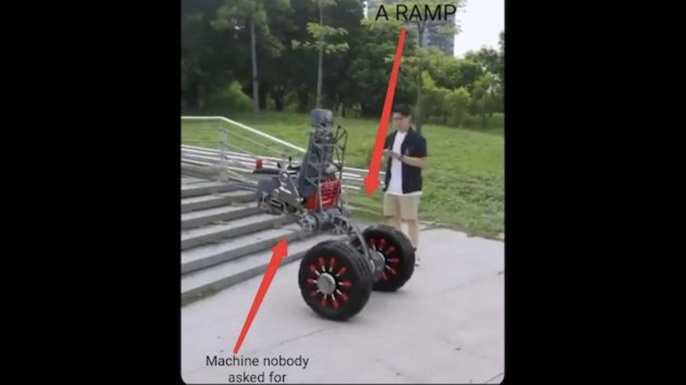
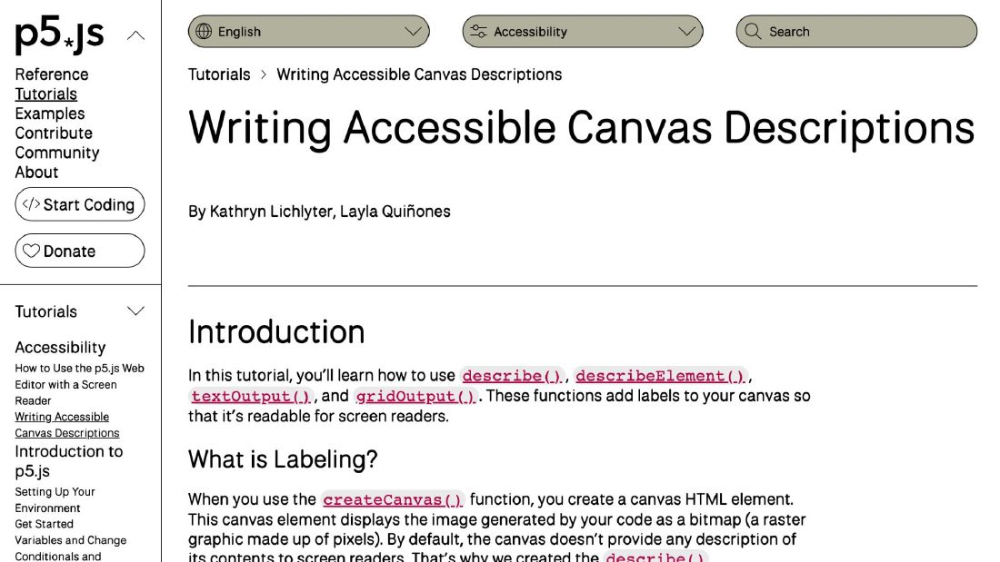
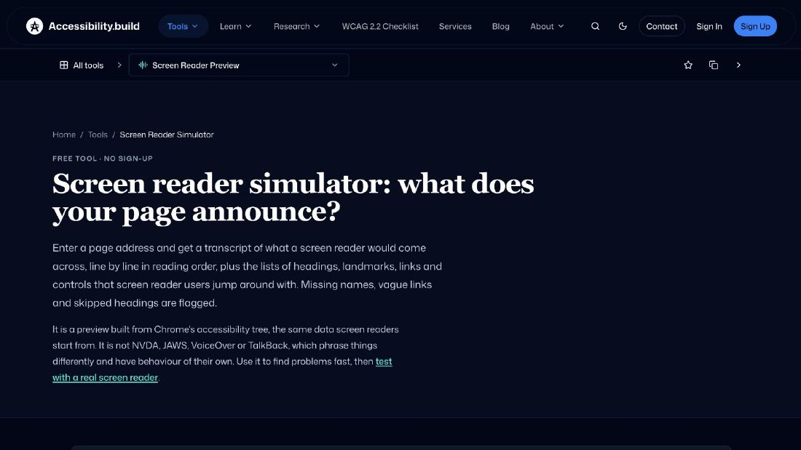
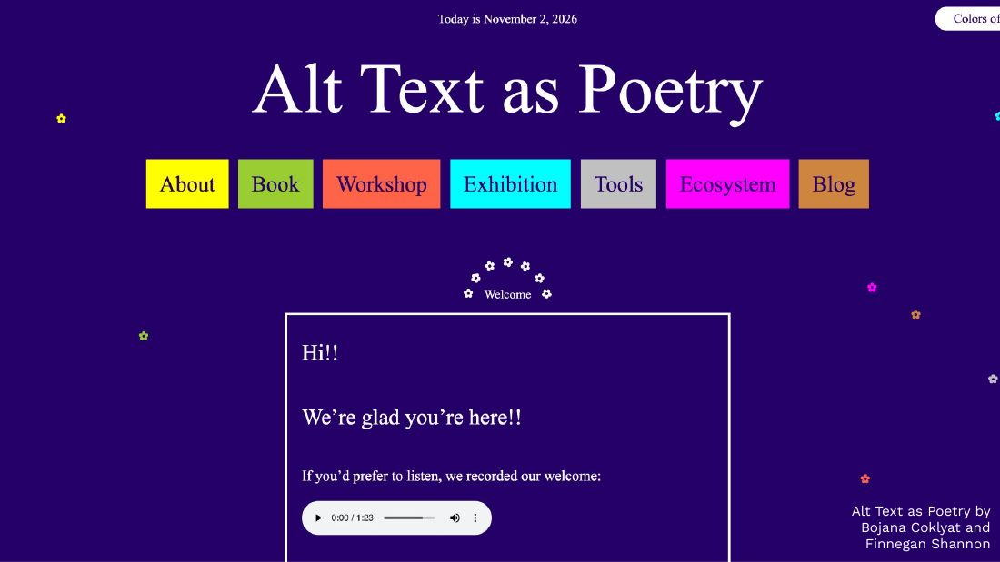
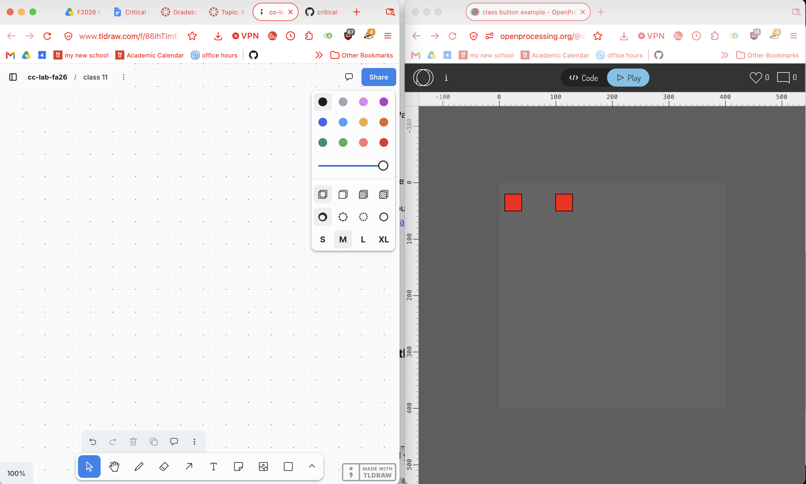

# Week 11: 11/6/2026

## Agenda

1. [Housekeeping](#housekeeping)
2. [Feedback Check-in](#feedback-check-in)
3. [Lecture #9 Discussion: Critical Disability and Design](#lecture-9-discussion-critical-disability-and-design)
4. [Assignment #7 Part 3: Science Fair Feedback](#assignment-7-part-3-science-fair-feedback)
5. [Review Session](#review-session)
6. [Tutorial: Arrays, Images, DOM & p5 Controls](#tutorial-arrays-images-dom--p5-controls)
    - [Arrays Review: Adding & Removing](#arrays-review-adding--removing)
    - [Importing Images](#importing-images)
    - [A Lite Intro to HTML / CSS](#a-lite-intro-to-html--css)
    - [Canvas vs. DOM](#canvas-vs-dom)
    - [createButton()](#1-createbutton-next-scene)
    - [createSlider()](#2-createslider-size)
    - [createCheckbox()](#3-createcheckbox-reduce-motion)
    - [createRadio()](#4-createradio-pick-a-palette)
    - [createSelect()](#5-createselect-jump-to-a-scene)
    - [createInput()](#6-createinput-name-your-character)
    - [Describing the canvas](#7-describing-the-canvas)
7. [Livecode: Frogger](#livecode-frogger)
8. [Pair Exercise: Picking Fruit](#pair-exercise-picking-fruit)
9. [Assignment #7 [Part 4]](#assignment-7-part-4)
10. [Extra Review Materials](#extra-review-materials)
11. [Coding Glossary](#coding-glossary)

## Housekeeping

1. Attendance
2. Questions from lecture?
3. Upcoming assignment: #7 Part 4, due 11/12
4. Next week's lecture: **CC Portfolio**. Make sure every assignment so far is linked in your portfolio.

[Back to top](#agenda)

---

## Feedback Check-in

Responding to your feedback to make this class better!

If there's anything else you'd like addressed, you can always send me an email, book office hours, or fill out the [anonymous feedback form]

[Back to top](#agenda)

---

## Lecture #9 Discussion: Critical Disability and Design

### Notes

Three ideas from the lecture that matter for how we code:

- **Social model of disability**: people are disabled by barriers in environments and design, not by their bodies. In code, the barrier is often *us*: a sketch that only works with a mouse, small text, or fast flashing motion.
- **Disability Dongle** (Liz Jackson, 2019): a well-meant, elegant, useless solution to a problem disabled people never said they had. The stair-climbing robot wheelchair vs. **a ramp**. Before building a clever fix, ask whether a plain one already exists (a real `<button>` instead of a `rect()` you made clickable).
- **Access as friction** (Hamraie & Fritsch, *Crip Technoscience Manifesto*): making something accessible pushes back on how it was built. That friction tells you something about your code.

<p>
  
  
</p>

#### Tools from the lecture

- **p5.js: [Writing Accessible Canvas Descriptions](https://p5js.org/tutorials/writing-accessible-canvas-descriptions/)** (Kathryn Lichlyter, Layla Quiñones). By default your canvas is just pixels: a screen reader announces nothing. `describe()`, `describeElement()`, `textOutput()`, and `gridOutput()` fix that. *We'll use these today.*
- **Screen reader simulator** (accessibility.build): see what a screen reader announces for a webpage.
- **Bojana Coklyat & Finnegan Shannon, *Alt Text as Poetry***: image descriptions as a creative practice, not a checkbox.

<p>
  
  
</p>


### Discuss

Quick pair discussion (5 min), pick one:

1. **What assumptions are you bringing to your game when defining how someone can interact with your project?** (Mouse? Keyboard? Seeing the screen? Reading fast? Knowing the controls already?)
2. Your p5 sketch is a `<canvas>`: to a screen reader, a blank rectangle. What would your origin story need to *say* to someone who can't see it?
3. Name one barrier in your own Assignment #7 sketch (mouse-only, small text, fast motion, color-only meaning). How would you remove it?
4. Is there a "dongle" in your code: a complicated fix where a simple built-in element would work?

[Back to top](#agenda)

---

## Assignment #7 Part 3:

1. Set up your computer to receive feedback:
    - [Option 1] using pen + paper

    

2. **~5 minutes:**
    - Write the **instructions** for how to interact with your prototype. (Notice which inputs you're assuming: mouse, keyboard, sight, sound.)
    - Write 2–3 **technical and/or conceptual questions** you need answers for.
3. **~20 minutes:**
    - Go around the room science-fair style and see what your peers have made.
    - Write notes of feedback, questions, and confusion.
    - If you can answer any of your peers' questions, note your answers.
    - Try at least one project **without the mouse**. Could you follow it?

[Back to top](#agenda)

---

## Review Session

From last class's whiteboard and the questions you just wrote, what do we need to review? We'll livecode the most common ones together. Likely candidates:

- **"I want a real button / menu / slider."** → p5 DOM controls (below).
- **"I want the viewer to type something into my story."** → `createInput()` (below).
- **"I want to add / remove characters."** → `push()` and `splice()` (below).
- **"I want to use my own drawings or photos."** → `loadImage()` (below).
- **"Can someone who can't see the canvas follow my story?"** → `describe()` (below).
- Last week: mouse & key inputs, `switch` scenes, collision detection ([Class 10 Notes](https://github.com/samheckle/critical-computation-lab-fa-26/tree/main/class_10)).

[Back to top](#agenda)

---

## Tutorial: Arrays, Images, DOM & p5 Controls

- Arrays review: `push()`, `pop()`, `shift()`, `unshift()`, `splice()`
- Importing images: `async setup()`, `await loadImage()`, `image()`
- A lite intro to HTML / CSS, and the DOM
- How DOM elements are different from the canvas
- `createButton()`, `createSlider()`, `createCheckbox()`, `createRadio()`, `createSelect()`, `createInput()`
- Describing your canvas: `describe()`, `textOutput()`

### Arrays Review: Adding & Removing

Your objects live in arrays. These methods change the array **in place**:

| Method | Does | Returns |
| --- | --- | --- |
| `arr.push(x)` | adds `x` to the **end** | the new length |
| `arr.pop()` | removes the **last** item | the removed item |
| `arr.unshift(x)` | adds `x` to the **front** | the new length |
| `arr.shift()` | removes the **first** item | the removed item |
| `arr.splice(i, n)` | removes `n` items starting at index `i` | an **array** of the removed items |

```js
// push / pop / shift / unshift / splice
// Open the console and read along.

let fruit = ["apple", "pear"];

fruit.push("plum");        // ["apple", "pear", "plum"]
fruit.unshift("fig");      // ["fig", "apple", "pear", "plum"]

let last = fruit.pop();    // last = "plum"   -> ["fig", "apple", "pear"]
let first = fruit.shift(); // first = "fig"   -> ["apple", "pear"]

fruit.push("kiwi", "lime");          // ["apple", "pear", "kiwi", "lime"]
let removed = fruit.splice(1, 2);    // removed = ["pear", "kiwi"] -> ["apple", "lime"]

console.log(fruit, last, first, removed);
```

#### Removing objects while you loop: go **backwards**

If you `splice()` while looping forwards, every item after it shifts down one index and the loop skips the next one. Loop from the end instead.

```js
// Click a circle to remove it from the array.

let dots = [];

function setup() {
  createCanvas(600, 400);
  for (let i = 0; i < 15; i++) {
    dots.push({ x: random(width), y: random(height), r: 25 });
  }
}

function draw() {
  background(240);
  fill(255, 120, 80);
  for (let d of dots) {
    circle(d.x, d.y, d.r * 2);
  }
  fill(0);
  text("dots left: " + dots.length, 10, 20);
}

function mousePressed() {
  for (let i = dots.length - 1; i >= 0; i--) {
    if (dist(mouseX, mouseY, dots[i].x, dots[i].y) < dots[i].r) {
      dots.splice(i, 1);
    }
  }
}
```

**Try it**

- Change the loop to go forwards. Overlap a few circles and click them. What gets skipped?
- Use `push()` in `keyPressed()` to add a new dot at the mouse.

### Importing Images

In p5.js 2.x, `loadImage()` returns a **promise**: a value that isn't ready yet. Make `setup()` an **`async`** function and **`await`** the image, so the sketch waits until it's loaded. Upload the file to your sketch first (in OpenProcessing, the **Files** tab; in the p5 editor, **Sketch Files → + → Upload file**).

```js
// async setup() + await loadImage() + image()
// Upload an image named "apple.png" to your sketch first.

let appleImg;

async function setup() {
  createCanvas(600, 400);
  appleImg = await loadImage("apple.png"); // wait here until it's loaded
  imageMode(CENTER); // draw images from their center, like circle()
}

function draw() {
  background(240);
  image(appleImg, mouseX, mouseY, 80, 80); // image, x, y, width, height
  describe("A red apple that follows the mouse.");
}
```

- `async` goes before `function setup()`; `await` goes before every `load___()` call.
- `draw()` doesn't start until `setup()` finishes, so the image is always ready by then.
- Loading several images? `await` each one: `pearImg = await loadImage("pear.png");`

> **Older tutorials (p5.js 1.x)**, including the Frogger video, use `function preload() { img = loadImage("apple.png"); }` with no `async` / `await`. In 2.x, `preload()` never runs, so the image is never loaded. To see which version your sketch uses, open the HTML file and look at the p5.js `<script>` tag in `<head>`.

**Try it**

- Pass the image into a class: `new Fruit(x, y, appleImg)`, then draw it in `show()`.
- Delete `await`. What happens, and why?

### A Lite Intro to HTML / CSS

Your sketch lives inside a web page. To add buttons and sliders, it helps to know what a web page is made of.

**HyperText Markup Language (HTML)** isn't a programming language, but a way to organize words on a page by "tagging" them.

#### Comments

```html
<!-- this is a comment in HTML -->
```

#### The `<html>` tag

HTML follows a particular structure. The first tag is always `<html>`, and everything else goes between its opening and closing tags. Every HTML tag is also called an **element**: a thing that exists on the page.

```html
<!-- opening -->
<html>
<!-- closing -->
</html>
```

#### Looking at the HTML file in OpenProcessing

In the OpenProcessing editor, change the mode to `HTML/CSS/JS`:


Open the HTML file and you can see the web code:


`<html>` has two **child** elements (tags nested between its opening and closing tags):

- `<head>`: extra data about the page (title, which scripts to load, like p5.js). It isn't shown on the page.
- `<body>`: the actual content of the page. Your canvas ends up here.

Some other tags (not a complete list):

| Tag | What it is |
| --- | --- |
| `<p>` | paragraph |
| `<em>` | emphasis / italics |
| `<strong>` | bold |
| `` | image; the `src` attribute is the path to the file. Its `alt` attribute is the description a screen reader reads. |
| `<a>` | link; the `href` attribute is where it goes |
| `<button>`, `<input>`, `<select>` | controls; what `createButton()`, `createInput()`, and `createSelect()` make for you |

See the [full list of HTML elements on MDN](https://developer.mozilla.org/en-US/docs/Web/HTML/Reference/Elements).

#### CSS

**Cascading Style Sheets (CSS)** decide what the page looks like. CSS is a list of rules that look a lot like objects with properties: a **selector** (which elements), then **property: value** pairs.

```css
/* this is a comment in css */

p {
  /* selector: which tag/element we want to style */
  color: blue; /* rule as a property: value pair */
}
```

The default `.css` file:


See the [full list of CSS properties on MDN](https://developer.mozilla.org/en-US/docs/Web/CSS/Reference/Properties). In p5, `.style("color", "blue")` sets the same thing on one element from JavaScript.

#### The DOM

The **Document Object Model** is how JavaScript sees the HTML page so it can change it: *Document* = the HTML document (`index.html`); *Object Model* = a JavaScript object, `document`, that represents it as a tree.


p5.js has a whole set of functions for [adding and changing elements in the DOM](https://p5js.org/reference/#DOM). That's what the rest of this tutorial uses.

### Canvas vs. DOM

Your p5 canvas is **one** element in the DOM tree (a `<canvas>` inside `<body>`), and everything you draw inside it is just pixels.

| | Drawn on the **canvas** (`rect()`, `text()`) | **DOM** element (`createButton()`) |
| --- | --- | --- |
| What is it? | pixels | a real HTML element |
| Does a screen reader know it's there? | no (unless you `describe()` it) | yes |
| Can you reach it with the Tab key? | no | yes |
| Who handles clicks? | you: `mousePressed()` + collision math | the browser: you give it a callback function |
| Where does it go? | inside the canvas | below the canvas, unless you `.position(x, y)` it |

So a "button" you drew with `rect()` and `dist()` only works for someone using a mouse who can see it. A button made with `createButton()` already works with a keyboard and a screen reader, for free. **Access starts with picking the right element.**

Every `create___()` function returns a **p5.Element** object. Like your classes, it has properties and methods:

| Method | What it does |
| --- | --- |
| `.position(x, y)` | moves it on the page |
| `.size(w, h)` | sets its size |
| `.style("property", "value")` | CSS: `.style("font-size", "20px")` |
| `.value()` | reads its current value (slider, input, select, radio) |
| `.mouseClicked(fn)` / `.changed(fn)` / `.input(fn)` | runs your function when something happens |
| `.attribute("aria-label", "...")` | gives it a name a screen reader will announce |
| `.remove()` | deletes it from the page |

Notice the **callback** pattern: you pass a function *name* (no parentheses!) and p5 calls it later. `button.mouseClicked(nextScene)`, not `button.mouseClicked(nextScene())`.

#### In-class examples

Paste each into a new sketch (OpenProcessing or the [p5 editor](https://editor.p5js.org/)) and run it. The first line of each is a comment that says what to do.

##### 1. `createButton()`: next scene

A button that moves through scenes. Try it with **Tab** and **Enter** instead of the mouse.

```js
// createButton(): a real HTML button
// Click it, OR press Tab to focus it and Enter / Space to press it.

let scenes = ["title", "story", "end"];
let current = 0;
let button;

function setup() {
  createCanvas(600, 400);
  textAlign(CENTER, CENTER);
  textSize(32);

  button = createButton("next scene");
  button.position(20, height + 20);
  // mouseClicked() listens for "click", which keyboards trigger too.
  // mousePressed() only listens for the mouse.
  button.mouseClicked(nextScene);
}

function draw() {
  background(40, 30, 80);
  fill(255);
  text(scenes[current], width / 2, height / 2);
}

function nextScene() {
  current++;
  if (current >= scenes.length) {
    current = 0;
  }
}
```

**Try it**

- Change `mouseClicked` to `mousePressed`. Now Tab to the button and press Enter. What broke?
- Add a "back" button.
- Add a global `function mousePressed() { background(255, 0, 0); }`. Click the button. Why does that run too?

##### 2. `createSlider()`: size

`createSlider(min, max, start, step)`. Read it with `.value()` every frame.

```js
// createSlider(min, max, start, step)
// Drag the slider, or Tab to it and use the arrow keys.

let slider;
let label;

function setup() {
  createCanvas(600, 400);

  label = createSpan("circle size: ");
  label.position(20, height + 20);

  slider = createSlider(10, 300, 100, 1);
  slider.position(130, height + 20);
  slider.attribute("aria-label", "circle size"); // a name for screen readers
}

function draw() {
  background(240);
  let size = slider.value();

  fill(255, 120, 80);
  circle(width / 2, height / 2, size);

  label.html("circle size: " + size);
}
```

**Try it**

- Add a second slider for color.
- Set the step to `10`. What changes?

##### 3. `createCheckbox()`: reduce motion

`createCheckbox(label, startChecked)`. `.checked()` is `true` or `false`. A **reduce motion** setting is a real accessibility feature: fast or flashing animation can cause dizziness, nausea, or seizures.

```js
// createCheckbox(label, checked)
// Check the box to stop the bubbles moving.

let bubbles = [];
let calm;

function setup() {
  createCanvas(600, 400);
  for (let i = 0; i < 20; i++) {
    bubbles.push(new Bubble(random(width), random(height)));
  }

  calm = createCheckbox(" reduce motion", false);
  calm.position(20, height + 20);
}

function draw() {
  background(20, 40, 60);
  for (let b of bubbles) {
    if (!calm.checked()) {
      b.move();
    }
    b.show();
  }
}

class Bubble {
  constructor(x, y) {
    this.x = x;
    this.y = y;
    this.r = random(10, 30);
  }

  move() {
    this.x += random(-5, 5);
    this.y += random(-5, 5);
  }

  show() {
    noStroke();
    fill(120, 200, 255, 180);
    circle(this.x, this.y, this.r * 2);
  }
}
```

**Try it**

- Instead of stopping, make reduce motion move the bubbles slower: pass a speed into `move(speed)`.
- Use `calm.changed(fn)` to print `"motion: off"` to the console only when the box changes.

##### 4. `createRadio()`: pick a palette

A radio is a group where you can only pick **one**. `.option(value)` adds a choice, `.selected(value)` sets the starting one, `.value()` reads it.

```js
// createRadio(): pick exactly one option
// Choose a palette. Try the arrow keys once one option is focused.

let radio;

function setup() {
  createCanvas(600, 400);
  textAlign(CENTER, CENTER);
  textSize(28);

  radio = createRadio();
  radio.option("default");
  radio.option("high contrast");
  radio.option("dark");
  radio.selected("default");
  radio.position(20, height + 20);
}

function draw() {
  let bg;
  let fg;

  switch (radio.value()) {
    case "default":
      bg = color(250, 230, 180);
      fg = color(150, 120, 90);
      break;
    case "high contrast":
      bg = color(255);
      fg = color(0);
      break;
    case "dark":
      bg = color(20);
      fg = color(230);
      break;
  }

  background(bg);
  fill(fg);
  text("Once, there was a seed.", width / 2, height / 2);
}
```

**Try it**

- Which palette is hardest to read? Check it with a [contrast checker](https://webaim.org/resources/contrastchecker/).
- Add a fourth palette.

##### 5. `createSelect()`: jump to a scene

A drop-down menu. `.changed(fn)` runs your function only when the viewer picks something new. Pairs nicely with last week's `switch`.

```js
// createSelect(): a drop-down menu
// Pick a scene from the menu.

let menu;
let scene = "title";

function setup() {
  createCanvas(600, 400);
  textAlign(CENTER, CENTER);
  textSize(28);

  menu = createSelect();
  menu.option("title");
  menu.option("story");
  menu.option("end");
  menu.position(20, height + 20);
  menu.attribute("aria-label", "choose a scene");
  menu.changed(pickScene);
}

function pickScene() {
  scene = menu.value();
}

function draw() {
  switch (scene) {
    case "title":
      background(40, 30, 80);
      fill(255);
      text("An Origin Story", width / 2, height / 2);
      break;
    case "story":
      background(250, 230, 180);
      fill(0);
      text("Once, there was a seed.", width / 2, height / 2);
      break;
    case "end":
      background(20);
      fill(255);
      text("The end.", width / 2, height / 2);
      break;
  }
}
```

**Try it**

- Keep the menu in sync: when a key press changes the scene, call `menu.selected(scene)`.

##### 6. `createInput()`: name your character

A text box. `.input(fn)` runs every time the text changes; `.value()` reads it.

```js
// createInput(): a text box
// Type a name. The character on the canvas takes it.

let nameBox;
let charName = "the seed";

function setup() {
  createCanvas(600, 400);
  textAlign(CENTER, CENTER);
  textSize(28);

  createSpan("name your character: ").position(20, height + 20);
  nameBox = createInput("");
  nameBox.position(200, height + 20);
  nameBox.attribute("aria-label", "name your character");
  nameBox.input(rename);
}

function rename() {
  charName = nameBox.value();
  if (charName === "") {
    charName = "the seed";
  }
}

function draw() {
  background(250, 230, 180);
  fill(90, 160, 60);
  circle(width / 2, 260, 40);
  fill(0);
  text("Once, there was " + charName + ".", width / 2, 150);
}
```

**Try it**

- Add a button that says "plant" and only updates the name when it's clicked.
- Type a really long name. How could you keep it on the canvas? (Hint: `text()` with a width and height.)

##### 7. Describing the canvas

`describe(text)` gives your canvas a description that screen readers announce (it's hidden from sighted viewers). `textOutput()` goes further: p5 writes an automatic list of the shapes on the canvas. Turn on your computer's screen reader (VoiceOver on Mac: **Cmd + F5**; Narrator on Windows: **Ctrl + Win + Enter**) and listen.

```js
// describe() and textOutput()
// Move the mouse. Open the browser inspector or a screen reader to hear the description.

function setup() {
  createCanvas(600, 400);
  textOutput(); // auto-describes shapes; remove this to hear only describe()
}

function draw() {
  background(250, 230, 180);

  let side = "left";
  if (mouseX > width / 2) {
    side = "right";
  }

  fill(90, 160, 60);
  circle(mouseX, 300, 40);

  // describe() can change as the sketch changes
  describe("A small green seed on sandy ground, on the " + side + " side of the field.");
}
```

**Try it**

- Use `describe(text, LABEL)` to also show the description under the canvas (for everyone).
- Write two descriptions of your origin story: one **literal**, one **poetic**. Which one tells you more?

#### All together

A tiny origin story with a control panel: button for scenes, slider for text size, checkbox for motion, radio for palette, input for a name, and a description that updates.

```js
let scenes = ["title", "story", "end"];
let current = 0;
let seedY = 0;

let nextBtn, sizeSlider, calmBox, paletteRadio, nameBox;

function setup() {
  createCanvas(600, 400);
  textAlign(CENTER, CENTER);

  nextBtn = createButton("next scene");
  nextBtn.position(20, height + 20);
  nextBtn.mouseClicked(nextScene);

  sizeSlider = createSlider(16, 48, 28, 2);
  sizeSlider.position(130, height + 20);
  sizeSlider.attribute("aria-label", "text size");

  calmBox = createCheckbox(" reduce motion", false);
  calmBox.position(300, height + 20);

  paletteRadio = createRadio();
  paletteRadio.option("default");
  paletteRadio.option("high contrast");
  paletteRadio.selected("default");
  paletteRadio.position(20, height + 60);

  nameBox = createInput("the seed");
  nameBox.position(300, height + 60);
  nameBox.attribute("aria-label", "name your character");
}

function draw() {
  let bg = color(250, 230, 180);
  let fg = color(80);
  if (paletteRadio.value() === "high contrast") {
    bg = color(255);
    fg = color(0);
  }
  background(bg);
  fill(fg);
  textSize(sizeSlider.value());

  let who = nameBox.value();
  let scene = scenes[current];

  switch (scene) {
    case "title":
      text("An Origin Story", width / 2, height / 2);
      describe("Title screen: An Origin Story.");
      break;
    case "story":
      if (!calmBox.checked()) {
        seedY = 20 * sin(frameCount * 0.05);
      } else {
        seedY = 0;
      }
      text("Once, there was " + who + ".", width / 2, 120);
      fill(90, 160, 60);
      circle(width / 2, 280 + seedY, 40);
      describe("Story: " + who + ", a small green seed, rests on the ground.");
      break;
    case "end":
      text("The end.", width / 2, height / 2);
      describe("End screen.");
      break;
  }
}

function nextScene() {
  current = (current + 1) % scenes.length; // % wraps back to 0
}
```

**Try it**

- Unplug your mouse (or don't touch the trackpad). Can you get all the way through the story with **Tab**, arrow keys, **Space**, and **Enter**?

[Back to top](#agenda)

---

## Livecode: Frogger

Everything from the last few weeks in one game. We'll build it together, one piece at a time; the full code is below so you can check your work.

| Concept | Where it shows up |
| --- | --- |
| classes & objects | `Frog` and `Car` |
| arrays: `push()` / `splice()` / `pop()` | cars spawn with `push()`, leave with `splice()` (backwards loop); lives are lost with `pop()` |
| collision detection | `frog.hits(car)`: rectangle vs. rectangle |
| key inputs | `keyPressed()` hops the frog with the arrow keys |
| scenes with `switch` | `"title"`, `"play"`, `"win"`, `"lose"` |
| DOM controls | start / restart button, traffic speed slider, on-screen arrow buttons |
| access | arrow keys **or** buttons; slow traffic down; `describe()` says what's happening |
| images | swap the emoji for images with `await loadImage()` (below) |

```js
// FROGGER
// Press start. Arrow keys (or the on-screen buttons) hop the frog.
// Cross the road 3 times to win. You have 3 lives.

let scene = "title";
let frog;
let cars = [];
let lives = [];
let score = 0;

let startBtn, speedSlider;

// each lane: where it is, which way it drives, what drives in it
let lanes = [
  { y: 120, dir: 1, kind: "🚗" },
  { y: 160, dir: -1, kind: "🚙" },
  { y: 200, dir: 1, kind: "🚚" },
  { y: 240, dir: -1, kind: "🚕" },
  { y: 280, dir: 1, kind: "🚌" },
];

function setup() {
  createCanvas(400, 400);
  textAlign(CENTER, CENTER);
  frog = new Frog();

  // DOM: start / restart
  startBtn = createButton("start");
  startBtn.position(20, height + 20);
  startBtn.mouseClicked(startGame);

  // DOM: traffic speed (slow it down if you need to)
  createSpan("traffic speed").position(100, height + 20);
  speedSlider = createSlider(0.25, 3, 1, 0.25);
  speedSlider.position(200, height + 20);
  speedSlider.attribute("aria-label", "traffic speed");

  // DOM: on-screen arrows, a second way to move
  let up = createButton("↑");
  up.position(20, height + 60);
  up.attribute("aria-label", "hop up");
  up.mouseClicked(hopUp);

  let left = createButton("←");
  left.position(60, height + 60);
  left.attribute("aria-label", "hop left");
  left.mouseClicked(hopLeft);

  let down = createButton("↓");
  down.position(100, height + 60);
  down.attribute("aria-label", "hop down");
  down.mouseClicked(hopDown);

  let right = createButton("→");
  right.position(140, height + 60);
  right.attribute("aria-label", "hop right");
  right.mouseClicked(hopRight);
}

function draw() {
  switch (scene) {
    case "title":
      background(40, 90, 50);
      fill(255);
      textSize(40);
      text("FROGGER 🐸", width / 2, 160);
      textSize(18);
      text("press start", width / 2, 230);
      describe("Title screen: Frogger. Press the start button below the canvas.");
      break;
    case "play":
      playGame();
      break;
    case "win":
      background(255, 220, 80);
      fill(0);
      textSize(32);
      text("You made it! 🐸", width / 2, height / 2);
      describe("You win! The frog crossed the road 3 times. Press restart to play again.");
      break;
    case "lose":
      background(30);
      fill(255);
      textSize(32);
      text("Game over", width / 2, height / 2);
      describe("Game over. Score: " + score + " of 3. Press restart to play again.");
      break;
  }
}

function startGame() {
  scene = "play";
  score = 0;
  cars = [];
  lives = ["❤️", "❤️", "❤️"];
  frog.reset();
  startBtn.html("restart");
}

function playGame() {
  drawRoad();

  // push(): every 50 frames, maybe add a car to each lane
  if (frameCount % 50 === 0) {
    for (let lane of lanes) {
      if (random() < 0.6) {
        cars.push(new Car(lane));
      }
    }
  }

  // loop BACKWARDS because we splice() while looping
  for (let i = cars.length - 1; i >= 0; i--) {
    let c = cars[i];
    c.move(speedSlider.value());
    c.show();

    if (c.offscreen()) {
      cars.splice(i, 1); // splice(): remove cars that drove away
    } else if (frog.hits(c)) {
      lives.pop(); // pop(): lose a life
      frog.reset();
    }
  }

  frog.show();

  // reached the other side?
  if (frog.y <= 80) {
    score++;
    frog.reset();
    if (score >= 3) {
      scene = "win";
    }
  }

  if (lives.length === 0) {
    scene = "lose";
  }

  // HUD
  fill(255);
  textSize(18);
  text(lives.join(" "), 60, 20);
  text("score: " + score + " / 3", width - 70, 20);

  let hopsLeft = (frog.y - 80) / 40;
  describe(
    "Frogger. The frog is " + hopsLeft + " hops from the far side. " +
    cars.length + " cars on the road. Lives: " + lives.length +
    ". Score: " + score + " of 3."
  );
}

function drawRoad() {
  background(60, 140, 70); // grass
  noStroke();
  fill(70);
  rect(0, 100, width, 200); // road
  stroke(255, 220, 0);
  for (let y = 140; y < 300; y += 40) {
    for (let x = 0; x < width; x += 40) {
      line(x, y, x + 20, y); // lane markings
    }
  }
  noStroke();
}

// arrow keys and on-screen buttons both call hop()
function keyPressed() {
  if (key === "ArrowUp") {
    hopUp();
  } else if (key === "ArrowDown") {
    hopDown();
  } else if (key === "ArrowLeft") {
    hopLeft();
  } else if (key === "ArrowRight") {
    hopRight();
  }
}

function hopUp() {
  if (scene === "play") frog.hop("up");
}
function hopDown() {
  if (scene === "play") frog.hop("down");
}
function hopLeft() {
  if (scene === "play") frog.hop("left");
}
function hopRight() {
  if (scene === "play") frog.hop("right");
}

class Frog {
  constructor() {
    this.size = 30;
    this.step = 40;
    this.reset();
  }

  reset() {
    this.x = width / 2;
    this.y = 360;
  }

  hop(dir) {
    switch (dir) {
      case "up":
        this.y -= this.step;
        break;
      case "down":
        this.y += this.step;
        break;
      case "left":
        this.x -= this.step;
        break;
      case "right":
        this.x += this.step;
        break;
    }
    this.x = constrain(this.x, 20, width - 20);
    this.y = constrain(this.y, 40, 360);
  }

  // rectangle vs. rectangle (x, y are the CENTER of each)
  hits(car) {
    return (
      this.x - this.size / 2 < car.x + car.w / 2 &&
      this.x + this.size / 2 > car.x - car.w / 2 &&
      this.y - this.size / 2 < car.y + car.h / 2 &&
      this.y + this.size / 2 > car.y - car.h / 2
    );
  }

  show() {
    textSize(this.size);
    text("🐸", this.x, this.y);
  }
}

class Car {
  constructor(lane) {
    this.y = lane.y;
    this.dir = lane.dir;
    this.kind = lane.kind;
    this.w = 36;
    this.h = 28;
    this.speed = random(1.5, 2.5);
    // start just off the edge it drives in from
    if (this.dir === 1) {
      this.x = -20;
    } else {
      this.x = width + 20;
    }
  }

  move(speedScale) {
    this.x += this.speed * this.dir * speedScale;
  }

  offscreen() {
    return this.x < -40 || this.x > width + 40;
  }

  show() {
    textSize(30);
    text(this.kind, this.x, this.y);
  }
}
```

#### Swap in images

Upload `frog.png` and `car.png` to your sketch. Make `setup()` **async** and **await** each image, then use `image()` instead of `text()` in each class's `show()`.

```js
let frogImg, carImg;

async function setup() {
  createCanvas(400, 400);
  frogImg = await loadImage("frog.png");
  carImg = await loadImage("car.png");
  imageMode(CENTER);
  // ...the rest of setup() stays the same
}

// in Frog:
//   show() { image(frogImg, this.x, this.y, this.size, this.size); }
// in Car:
//   show() { image(carImg, this.x, this.y, this.w, this.h); }
```

Images have no words in them, so your `describe()` matters even more.

**Try it**

- **Flies.** Add an array of `Fly` objects on the far side. When the frog `hits()` one, `splice()` it out and add 5 to the score.
- **Pause.** Add `createCheckbox(" pause")`. When it's checked, cars don't move and the frog can't hop.
- **Difficulty.** Add `createSelect()` with `"easy"`, `"normal"`, `"hard"` that changes how often cars spawn (the `50` in `frameCount % 50`).
- **More lives.** Add a heart with `lives.unshift("💚")` when the frog reaches the far side without being hit.
- **Gotcha:** click the traffic slider, then press the arrow keys. What happens to the slider *and* the frog? Why?

[Back to top](#agenda)

---

## Pair Exercise: Picking Fruit

A tree full of `Fruit` objects and an empty basket. Picking fruit means **moving objects from one array to another**: `splice()` out of `tree`, `push()` into `basket`. Then make it pickable for more people: with buttons, a menu, and a description.

Work in pairs, in one shared sketch titled "Picking Fruit".

### The starter

```js
// PICKING FRUIT
// Two arrays: the tree and the basket. Move fruit between them.
// Work through the steps in order. Run your sketch after each one.

let tree = [];
let basket = [];
let kinds = ["🍎", "🍐", "🍑", "🍋"];

function setup() {
  createCanvas(600, 500);
  textAlign(CENTER, CENTER);

  for (let i = 0; i < 12; i++) {
    tree.push(new Fruit(random(150, 450), random(80, 260), random(kinds)));
  }
}

function draw() {
  background(200, 230, 255);
  drawTree();

  for (let f of tree) {
    f.show();
  }

  drawBasket();
}

function drawTree() {
  noStroke();
  fill(120, 80, 50);
  rect(280, 250, 40, 150);
  fill(60, 140, 70);
  ellipse(300, 170, 380, 260);
}

function drawBasket() {
  fill(180, 130, 70);
  rect(0, 420, width, 80);
  // TODO: step 2
}

class Fruit {
  constructor(x, y, kind) {
    this.x = x;
    this.y = y;
    this.kind = kind;
    this.size = 32;
  }

  contains(px, py) {
    return dist(px, py, this.x, this.y) < this.size / 2;
  }

  show() {
    textSize(this.size);
    text(this.kind, this.x, this.y);
  }
}
```

### Steps

1. **Pick with the mouse.** In `mousePressed()`, loop **backwards** through `tree`. If a fruit `contains()` the mouse, `splice()` it out of `tree` and `push()` it into `basket`. (Hint: `splice()` returns an array, so grab `[0]`.)
2. **Show the basket.** In `drawBasket()`, loop through `basket` and draw each fruit in a row along the bottom: `x = 30 + i * 40`, `y = 460`. Show `basket.length` as a count.
3. **Pick without the mouse.** Add `createButton("pick one")`. It calls `pickRandom()`, which moves a random fruit from `tree` to `basket`. Use `.mouseClicked()` so Tab + Enter works. What happens when the tree is empty? Fix it.
4. **Eat & put back.** Add two more buttons:
    - `"eat one"`: `basket.pop()` (the last one picked is gone).
    - `"put one back"`: `basket.shift()` the *first* one picked and `push()` it back onto `tree` at a new random spot.
5. **Grow.** Add a `createSelect()` with the four kinds, and a `"grow"` button that `push()`es a new `Fruit` of the selected kind onto the tree. Add a `createSlider()` that sets the size of new fruit (bigger fruit = bigger click targets).
6. **Describe it.** In `draw()`, call `describe()` with a sentence that updates: how many fruit are on the tree, how many are in the basket. Turn on a screen reader and listen.

*Stretch (pick one):*

- **Images.** Swap the emoji for images: upload four files, `await loadImage()` them in `async function setup()`, and pass the image into the `Fruit` constructor.
- **Unshift.** Add a `"save for later"` button that takes the last fruit (`pop()`) and moves it to the front of the basket (`unshift()`).
- **Count by kind.** Make `describe()` say *what's* in the basket: "3 apples, 1 lemon." (Hint: loop through and count each `kind`.)
- **Ripe only.** Give each fruit a `ripe` property and add a `createCheckbox(" only pick ripe")`.

*Share-out:* one pair projects their sketch and picks, eats, and grows fruit **keyboard-only**.

<details>
<summary>One possible solution (steps 1–6)</summary>

```js
let tree = [];
let basket = [];
let kinds = ["🍎", "🍐", "🍑", "🍋"];

let pickBtn, eatBtn, backBtn, growBtn, kindMenu, sizeSlider;

function setup() {
  createCanvas(600, 500);
  textAlign(CENTER, CENTER);

  for (let i = 0; i < 12; i++) {
    tree.push(new Fruit(random(150, 450), random(80, 260), random(kinds), 32));
  }

  // 3. pick without the mouse
  pickBtn = createButton("pick one");
  pickBtn.position(20, height + 20);
  pickBtn.mouseClicked(pickRandom);

  // 4. eat & put back
  eatBtn = createButton("eat one");
  eatBtn.position(110, height + 20);
  eatBtn.mouseClicked(eatOne);

  backBtn = createButton("put one back");
  backBtn.position(190, height + 20);
  backBtn.mouseClicked(putBack);

  // 5. grow
  kindMenu = createSelect();
  for (let k of kinds) {
    kindMenu.option(k);
  }
  kindMenu.position(20, height + 60);
  kindMenu.attribute("aria-label", "kind of fruit to grow");

  sizeSlider = createSlider(20, 80, 32, 4);
  sizeSlider.position(90, height + 60);
  sizeSlider.attribute("aria-label", "size of new fruit");

  growBtn = createButton("grow");
  growBtn.position(250, height + 60);
  growBtn.mouseClicked(grow);
}

function draw() {
  background(200, 230, 255);
  drawTree();

  for (let f of tree) {
    f.show();
  }

  drawBasket();

  // 6. describe it
  describe(
    "A fruit tree with " + tree.length + " fruit on it. " +
    "The basket below holds " + basket.length + " fruit."
  );
}

function drawTree() {
  noStroke();
  fill(120, 80, 50);
  rect(280, 250, 40, 150);
  fill(60, 140, 70);
  ellipse(300, 170, 380, 260);
}

function drawBasket() {
  fill(180, 130, 70);
  rect(0, 420, width, 80);

  // 2. show the basket
  textSize(28);
  for (let i = 0; i < basket.length; i++) {
    text(basket[i].kind, 30 + i * 40, 460);
  }
  fill(0);
  textSize(16);
  text("basket: " + basket.length, width - 60, 440);
}

// 1. pick with the mouse
function mousePressed() {
  for (let i = tree.length - 1; i >= 0; i--) {
    if (tree[i].contains(mouseX, mouseY)) {
      let picked = tree.splice(i, 1)[0];
      basket.push(picked);
      return; // only pick one per click
    }
  }
}

// 3.
function pickRandom() {
  if (tree.length === 0) {
    return; // nothing left to pick
  }
  let i = floor(random(tree.length));
  let picked = tree.splice(i, 1)[0];
  basket.push(picked);
}

// 4.
function eatOne() {
  basket.pop();
}

function putBack() {
  if (basket.length === 0) {
    return;
  }
  let f = basket.shift();
  f.x = random(150, 450);
  f.y = random(80, 260);
  tree.push(f);
}

// 5.
function grow() {
  let f = new Fruit(random(150, 450), random(80, 260), kindMenu.value(), sizeSlider.value());
  tree.push(f);
}

class Fruit {
  constructor(x, y, kind, size) {
    this.x = x;
    this.y = y;
    this.kind = kind;
    this.size = size;
  }

  contains(px, py) {
    return dist(px, py, this.x, this.y) < this.size / 2;
  }

  show() {
    textSize(this.size);
    text(this.kind, this.x, this.y);
  }
}
```

Note: `basket.pop()` on an empty array just returns `undefined`, so `eatOne()` doesn't need a check. `splice()` and `shift()` on an empty array are safe too, but then `picked` / `f` is `undefined`, and drawing it would crash. That's why `pickRandom()` and `putBack()` check first.

</details>

[Back to top](#agenda)

---

## Assignment #7 [Part 4]

Finish Origin Stories, Part 4. Due Thursday 11/12.

Finish your origin story based on today's review. As you work:

1. **Controls:** add at least one p5 DOM control (button, slider, checkbox, radio, select, or input). What does it let the viewer change about your story?
2. **Keyboard:** can someone get through your whole story without a mouse? If not, what's one change that would make it possible?
3. **Motion & contrast:** does anything flash or move fast? Is your text big enough and high-contrast enough to read?
4. **Describe:** add `describe()` to every scene. Try one literal description and one poetic one.

Submit to the CC Lab Canvas assignment and add it to your portfolio. Next week is the **CC Portfolio** lecture, so check that every assignment is linked.

[Back to top](#agenda)

## Extra Review Materials

- p5.js Reference: [createButton()](https://p5js.org/reference/p5/createButton/), [createSlider()](https://p5js.org/reference/p5/createSlider/), [createCheckbox()](https://p5js.org/reference/p5/createCheckbox/), [createRadio()](https://p5js.org/reference/p5/createRadio/), [createSelect()](https://p5js.org/reference/p5/createSelect/), [createInput()](https://p5js.org/reference/p5/createInput/), [p5.Element](https://p5js.org/reference/p5/p5.Element/)
- p5.js Reference: [describe()](https://p5js.org/reference/p5/describe/), [describeElement()](https://p5js.org/reference/p5/describeElement/), [textOutput()](https://p5js.org/reference/p5/textOutput/), [gridOutput()](https://p5js.org/reference/p5/gridOutput/)
- p5.js Tutorial: [Writing Accessible Canvas Descriptions](https://p5js.org/tutorials/writing-accessible-canvas-descriptions/)
- Allison Parrish: [Browser Controls](https://creative-coding.decontextualize.com/browser-controls/)
- Coding Train: [HTML/CSS/DOM Playlist](https://www.youtube.com/watch?v=URSH0QpxKo8&list=PLRqwX-V7Uu6bI1SlcCRfLH79HZrFAtBvX) (videos 8.1–8.16)
- MDN: [Introduction to the DOM](https://developer.mozilla.org/en-US/docs/Web/API/Document_Object_Model/Introduction)
- WebAIM: [Contrast Checker](https://webaim.org/resources/contrastchecker/)
- [JavaScript push(), pop(), shift(), unshift()](https://www.youtube.com/watch?v=SSdPtuEvKyA&feature=youtu.be), [JavaScript splice()](https://www.youtube.com/watch?v=jhqZerkWkXc&feature=youtu.be)
- p5.js Reference: [loadImage()](https://p5js.org/reference/p5/loadImage/), [image()](https://p5js.org/reference/p5/image/)
- [Importing Image Assets - Frogger](https://youtu.be/pbUyIhtGuhc) (uses 1.x `preload()`; swap in `async setup()` + `await`)

## Coding Glossary

| Term | Meaning |
| --- | --- |
| `push()` / `pop()` | add to / remove from the **end** of an array |
| `unshift()` / `shift()` | add to / remove from the **front** of an array |
| `splice(i, n)` | remove `n` items starting at index `i`; returns them as an array |
| `async` / `await` | `async function setup()` lets you `await` a loading file; the sketch waits until it's ready |
| `loadImage()` / `image()` | load an image file / draw it on the canvas |
| HTML | HyperText Markup Language: "tags" text to define the structure of a web page |
| element / tag | one item on the page: `<p>`, `<a>`, `<div>`, a button, your canvas |
| attribute | extra info inside a tag: `src`, `href`, `alt`, `aria-label` |
| CSS | Cascading Style Sheets: styles HTML elements |
| selector | in CSS, which element(s) a rule applies to: `p` |
| property | in CSS, what you want to change: `color` |
| value | in CSS, what the property changes to: `blue` |
| DOM | Document Object Model: how JavaScript sees the HTML page (the `document`) so it can change it |
| p5.Element | the object p5 gives back from `createButton()`, `createSlider()`, etc. |
| callback | a function you hand to something else to run later: `button.mouseClicked(nextScene)` |
| `.value()` | reads the current value of a slider, input, select, or radio |
| `.checked()` | `true` or `false`: is the checkbox checked? |
| `.position(x, y)` | moves a DOM element on the page |
| `.changed(fn)` | runs `fn` when a select, radio, or checkbox changes |
| `.input(fn)` | runs `fn` every time the text in an input changes |
| focus | which element the keyboard is "on"; move it with Tab |
| `aria-label` | an attribute that gives an element a name for screen readers |
| screen reader | software that reads a screen out loud (VoiceOver, NVDA, JAWS, Narrator) |
| `describe()` | gives your canvas a description screen readers can announce |
| `textOutput()` | p5 automatically describes the shapes on your canvas |
| reduce motion | a setting that slows or stops animation for people who need it |
| disability dongle | a well-meant design that solves a problem disabled people never asked to have solved |

[Back to top](#agenda)
